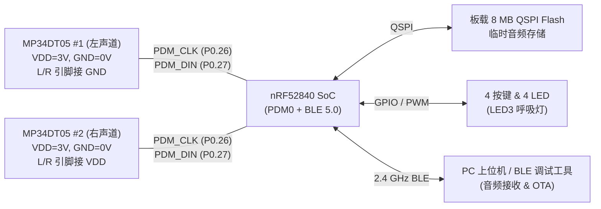
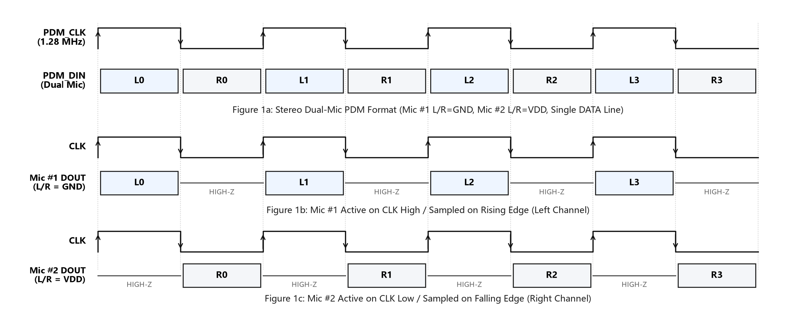
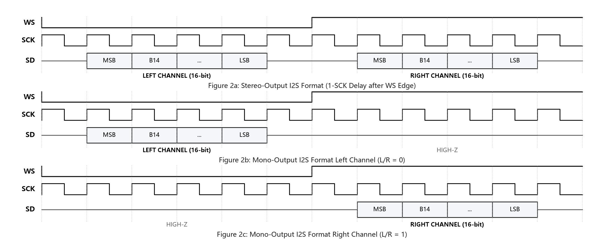
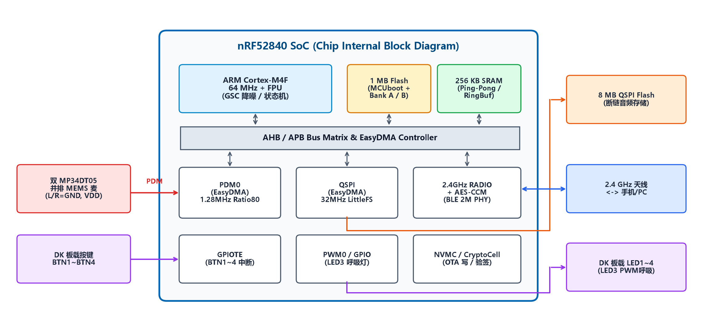
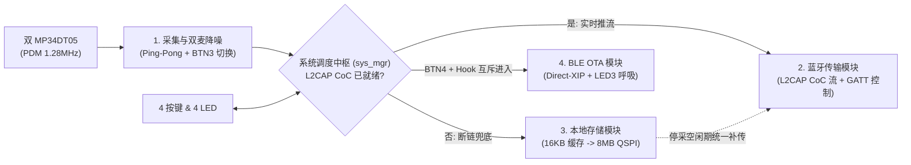

# BLEAudio — 基于 nRF52840 DK 的双 MEMS 麦克风降噪与实时蓝牙音频传输方案

本项目采用 **V 字模型（V-Model）** 开发，基于 **Nordic nRF52840 DK** 开发板，实现**双并排 MEMS 麦克风降噪采集**、**BLE 实时音频传输**、**8 MB QSPI 断链兜底存储与重连补传**，以及 **A/B Bank 蓝牙 OTA 升级**。

---

## 1. 软硬件资源与连接说明

### 1.1 核心硬件模块
* **主控芯片（nRF52840）**：ARM Cortex-M4F @ 64 MHz（带硬件浮点 FPU），内置 **1 MB Flash**、**256 KB SRAM**，集成硬件 `PDM` 音频接口与 BLE 5.0 射频。
* **片外存储（8 MB QSPI Flash）**：开发板板载 8 MB 外部高速 Flash，专门用于蓝牙未连接/断链时的**临时本地音频存储**，重连后补传。
* **双 MEMS 麦克风（2 × ST MP34DT05TR-A）**：**PDM 数字输出 MEMS 麦克风**（内置声学传感器 + $\Sigma\Delta$ 调制器，直接输出 1-bit PDM 数字脉冲流），采用**并排贴片（间距 2~4 cm，朝向一致）**。
* **完整信号处理链路**：
  $$\text{声音 (声波)} \xrightarrow{\text{2× MP34DT05}} \text{1-bit PDM 流 (1.280 MHz)} \xrightarrow{\text{nRF52840 PDM0 抽取}} \text{16 kHz / 16-bit PCM} \xrightarrow{\text{双麦降噪}} \text{BLE (L2CAP CoC)} \longrightarrow \text{PC 上位机}$$
* **板载交互（4 按键 + 4 LED）**：
  * `BTN1`：短按切换 **开启/停止采集**（`LED1` 对应采集状态）
  * `BTN2`：预留
  * `BTN3`：短按切换 **降噪开启 / 关闭**（`LED4` 指示降噪/异常）
  * `BTN4`：短按进入 **BLE OTA 升级**（点亮 `LED3` 呼吸灯，升级完成灭灯重启）
  * `LED2`：对应 **蓝牙连接状态**（慢闪=广播，常亮=已连接）

### 1.2 硬件连接示意图（芯片与模块层）
> **常见疑问：为什么两颗麦克风一个接 GND、一个接 VDD？接 GND 的不需要供电吗？**  
> **需要供电！** 两颗麦克风的 `VDD` 引脚**都必须接 3.0V 电源**，`GND` 引脚**都必须接地**。  
> 图中接 `GND` 和 `VDD` 的是麦克风的 **`L/R`（声道选择引脚）**：两颗麦共用同一根 `DIN` 数据线时，`L/R` 接 `GND` 的麦克风只在时钟高电平时输出数据（左声道），`L/R` 接 `VDD` 的麦克风只在时钟低电平时输出数据（右声道），另一半周期均处于高阻态，从而实现**单根数据线分时传输双声道**。



### 1.3 开发与调试软件工具
* **固件开发与编译**：VS Code + `nRF Connect for VS Code` + **nRF Connect SDK (NCS) v3.4.2**（Zephyr RTOS / `west` / MCUboot Sysbuild），**优先基于官方 SDK 示例工程裁剪移植**
* **烧录与日志查看**：板载 Segger J-Link（`west flash`）+ 串口 / SEGGER RTT 终端
* **协议与音频/时序调试**：
  * **WSL2 + BlueZ 上位机环境**：通过 `usbipd-win` 将 USB BLE 适配器或 `nRF52840 Dongle` 直通至 WSL2，运行支持 `AF_BLUETOOTH / L2CAP CoC` 的接收与自动化测试脚本
  * **BLE Sniffer + Wireshark**：抓取空口 `2M PHY`、`DLE 251B` 与 L2CAP CoC 音频流数据包
  * **nRF Connect Device Manager**：用于 GATT 控制调试与 BLE A/B Bank OTA 固件升级
  * **USB 逻辑分析仪软件**：抓取 `PDM_CLK` / `PDM_DIN` 与测试脚电平以实测内部延迟
  * **Audacity**：导入 `.pcm` / `.wav` 音频，对比降噪前后的时域波形与 FFT 频谱

---

## 2. 内存与存储资源总览 (Memory Map)

| 存储 / 内存介质 | 总容量 | 关键分区与用途摘要 |
| :--- | :--- | :--- |
| **片内 Flash** | **1 MB** | `mcuboot` (48~64 KB，关闭日志可控制在 48 KB) + Direct-XIP **Bank A / Bank B**（等分镜像槽，默认各 464 KB）+ `settings_storage` (48 KB)，仅存固件与绑定参数 |
| **片外 QSPI Flash** | **8 MB** | 挂载 **LittleFS**（`/lfs/<UTC>.pcm`），专门用于断链/蓝牙未就绪时的临时音频缓存 |
| **片内 SRAM** | **256 KB** | BLE 协议栈与内核 (~90 KB，需禁用 `OTA_DFU_SPEEDUP` 或经 `ram_report` 实测校准) + PDM/DSP/L2CAP CoC/16 KB QSPI 零拷贝缓冲 (~42 KB) + 线程栈 (~11.5 KB) + **安全余量 (~112 KB)** |

> 完整 `pm_static.yml` 地址映射、LittleFS 水位保护与 SRAM 零泄漏生命周期详见 [04_内存与存储管理详设.docx](doc/03_功能域详设/04_内存与存储管理详设.docx)。

---

## 3. 音频基础知识、接口对比与帧格式

### 3.1 数字音频接口对比：PCM、PDM 与 I2S
| 概念 / 接口 | 物理连线 | 数据形态与原理 | 典型应用与本项目选型 |
| :--- | :--- | :--- | :--- |
| **PCM** (编码格式) | 无特定引脚（指数据格式） | **脉冲编码调制**：按固定采样率（如 16 kHz）记录声音振幅的整数值（如 16-bit）。 | 是 DSP 算法处理、`.wav` 文件及蓝牙传输的**标准数据格式**。 |
| **I2S** (数字音频总线) | **3 根线**：`BCLK`(位时钟) + `LRCLK`(左右声道时钟) + `DATA` | 专门用于芯片间传输 **PCM 数据**的同步串行总线，`LRCLK` 高/低电平区分左右声道。 | 常用于连接外部音频编解码器（Codec）、DAC 或功放。本项目无需外挂 Codec，故不用 I2S。 |
| **PDM** (麦克风接口) | **2 根线**：`CLK`(时钟) + `DIN`(数据) | **脉冲密度调制**：用极高频的 `0/1` 脉冲密度代表音量大小（`1` 越密声音越大），省去一颗引脚与内部 ADC。 | **MP34DT05 原生输出 PDM**，直连 nRF52840 的 `PDM0` 硬件模块，由芯片内部硬件滤波器自动转成 PCM。 |

### 3.2 采样率计算与“为什么以 20 ms 为一个处理单元”
1. **精确 16 kHz 采样率推导**：
   nRF52840 `PDM0` 时钟源为 32 MHz，硬件支持 `64 倍` 或 `80 倍` 抽取。本方案选用 `32 MHz / 25 = 1.280 MHz` 配合 **80 倍抽取 (`Ratio80`)**：
   $$f_s = \frac{1,280,000\text{ Hz}}{80} = 16,000\text{ Hz (精确 16 kHz)}$$
2. **为什么音频处理以 20 ms 为一个单元？**
   * **太短（如 2~5 ms）**：采样点太少（仅 32~80 点），频率分辨率不足以做有效的频谱降噪，且频繁触发中断与 BLE 发包开销过大。
   * **太长（如 60~100 ms）**：端到端延迟显著增加，人耳会感知到明显滞后，且单个缓冲区占用 SRAM 翻倍。
   * **20 ms 是语音处理的黄金折中点**：人声在 10~30 ms 内可视为“短时平稳信号”；20 ms 对应 **320 个采样点**，既能保证双麦降噪与语音检测（VAD）效果，又能将设备端总延迟控制在 **30~40 ms** 以内。

### 3.3 音频硬件传输时序帧格式（PDM vs I2S）
1. **本项目 PDM 硬件时序（2 线分时复用）**：
   
2. **标准 I2S 信号格式（3 线 PCM 总线参考：Stereo / Mono Left / Mono Right）**：
   
3. **软件层 20 ms 音频帧（硬件抽取后）**：
   * **采集立体声 PCM（1280 B / 20 ms）**：`[L0(2B) | R0(2B) | L1(2B) | R1(2B) | ... | L319(2B) | R319(2B)]`
   * **降噪后单声道（640 B / 20 ms，Raw PCM 256 kbps）**：`[S0(2B) | S1(2B) | ... | S319(2B)]` -> 第 1 阶段直接通过 L2CAP CoC 整帧发送；第 2 阶段预留 **IMA-ADPCM (4:1)** 压缩为 `164 B / 20 ms`（65.6 kbps）。

### 3.4 帧独立性设计（自包含解码，杜绝丢包连环爆音）
在无线音频传输中，如果某帧在空口丢失或状态异常，绝不能影响后续帧的正常解码（防止出现刺耳的“连环爆音”）：
* **第 1 阶段 Raw PCM**：每个 16-bit 采样点本身就是绝对声压振幅，无跨帧状态依赖。任意帧丢失时，接收端仅需根据 `seq_num` 断号对该 20 ms 区间做静音/淡出填补（PLC），下一帧到达后立即恢复完美音质。
* **第 2 阶段 IMA-ADPCM（强制每帧自包含状态头）**：传统流式 ADPCM 的预测器状态（`prev_sample`, `step_index`）跨帧延续，一旦丢包就会导致后续所有帧预测失步、产生持续爆音。**本项目强制在每帧 SDU 载荷前嵌入该帧第 0 个采样点的初始状态 `(adpcm_prev 2B, adpcm_idx 1B)`**，使每一帧 20 ms 数据**完全自包含、可独立解码**，丢失前序任意帧均不会污染后续音频。

---

## 4. 蓝牙基础知识、帧格式与 PHY 协商机制

### 4.1 BLE 协议栈分层与核心概念
为了看懂后面的蓝牙数据包结构，先了解低功耗蓝牙（BLE）从底层硬件到上层应用的 5 个核心层级：

| 协议层 | 英文全称 | 通俗职责（对应到本项目的具体作用） |
| :--- | :--- | :--- |
| **PHY** | Physical Layer（物理层） | 负责 2.4 GHz 无线电波收发。BLE 4.0 只有 **1M PHY**（1 Mbps）；BLE 5.0 新增 **2M PHY**（2 Mbps，速率翻倍、空口发包时间减半）。 |
| **LL** | Link Layer（链路层） | 管理广播、扫描、建链、跳频、硬件重传（ACK）与 AES-CCM 加密。决定单包物理长度上限（默认 27B，开启 **DLE** 后扩展至 **251B**）。 |
| **L2CAP** | Logical Link Control & Adaptation Protocol | **高速流通道（L2CAP CoC）**：支持面向连接动态信道与**基于信用的流控（Credit-Based Flow Control）**，绕过 GATT/ATT 直接传输大块音频帧并自动分段重组。 |
| **ATT / GATT** | Attribute / Generic Attribute Profile | **通用属性配置文件**：仅用于**小包控制指令与状态同步**（如通知 PSM 端口号、降噪开关状态、CTS 时间同步、SMP OTA）。 |
| **APP** | Application Layer（应用层） | 本项目的音频流（走 L2CAP CoC）、控制/状态（走 GATT）与 OTA 升级。 |

**通信角色与双通道分工（控制面 vs 数据面分离）**：
* **Peripheral（从机，本项目开发板）** vs **Central（主机，PC 上位机）**：从机发出广播等待连接，PC 上位机作为唯一音频接收端主动发起连接。
* **为什么音频流不能用 GATT `Notify`，而必须用 `L2CAP CoC`？**
  * **GATT `Notify / Write`** 面向小数据包设计，只适合传输**控制指令（如启停/降噪开关/校时）和状态同步（如存储水位/PSM 端口号/丢帧统计）**；
  * **L2CAP CoC（Connection-Oriented Channels）** 是 BLE 4.2/5.0 专门用于高速流媒体/大数据的信道：完全绕过 ATT 层开销，支持**透明分段重组**（应用层直接把整帧 **650 B** 音频 SDU 一次性交由协议栈发送，无需手动拆包），并自带**基于信用的硬件/协议流控**，彻底避免盲发拥塞。
* **时间同步机制（CTS Client `0x1805` 与控制指令校时）**：
  * **什么是 CTS Client？** CTS（Current Time Service，GATT 标准服务 UUID `0x1805`）是蓝牙 SIG 定义的标准时间服务。由于 nRF52840 断电重启后 RTC 仅能从零计数，固件侧实现为 **CTS Client（时间客户端）**：连接建立后主动向主机（GATT CTS Server）请求读取当前时间与日期，从而为音频帧与 QSPI 本地录音打上真实 UTC 时间戳。
  * **PC 上位机校时兜底**：普通 PC 端测试工具或系统原生蓝牙栈往往未开启 GATT CTS Server 服务，因此固件在自定义 GATT 控制特征值（`0x1002`）中提供了 **`0x05 (SET_UTC_TIME)`** 校时指令，允许 PC 上位机在连上后直接下发 Unix 时间戳完成同步。

### 4.2 蓝牙音频传输机制对比：HFP vs 等时通道 (CIS/BIS) vs L2CAP CoC
为什么本项目不使用经典蓝牙 A2DP/HFP 或 LE Audio 等时通道（CIS/BIS），以及三者在底层传输格式上的本质区别如下：

| 对比维度 | 经典蓝牙 HFP (eSCO) | LE Audio 等时通道 (CIS / BIS) | 本项目 L2CAP CoC (LE ACL) |
| :--- | :--- | :--- | :--- |
| **所属标准与物理链路** | 经典蓝牙 BR/EDR（**eSCO 同步链路**） | BLE 5.2+（**LE Isochronous 等时物理信道**） | BLE 4.2/5.0（**LE ACL 异步逻辑链路**） |
| **nRF52840 是否支持** | **❌ 不支持**（无 BR/EDR 硬件基带；A2DP 亦仅支持单向放音，不支持录音） | **❌ 不支持**（无 LE ISO 硬件控制器；需 nRF5340 / nRF54L15） | **✅ 原生支持**（nRF52840 唯一符合流式传输规范的 BLE 通道） |
| **底层传输帧格式** | `基带包头 + 固定时隙语音帧 (CVSD/mSBC)`，**不经过 L2CAP/ATT** | `LL ISO Data PDU = LL 头 + ISOAL 分段头 + LC3 音频帧`，**不经过 L2CAP/ATT** | `LL Header(2B) + L2CAP Hdr(4B) + SDU Len(2B) + 音频 SDU + MIC(4B)` |
| **编码与典型码率** | CVSD (8 kHz, 64 kbps) 或 mSBC (16 kHz, 64 kbps) | 强制 **LC3**（16~48 kHz，低至 32 kbps 高音质） | 透传任意格式（第1阶段 Raw PCM 256 kbps，第2阶段 IMA-ADPCM 65.6 kbps） |
| **丢包与重传策略** | 固定时隙内有限次重传，超时直接丢弃旧帧 | **有界重传（Flush Timeout）**：超时自动丢弃过期帧，并带时间同步标记 | **LL 层无限重传直到连接超时** + **L2CAP 信用流控**；需应用层主动 **Drop-Oldest** 防延迟雪球 |

### 4.3 BLE 5.0 Link Layer 标准包格式与字节拆解


* **为什么 BLE 4.0 和 BLE 5.0 的包大小不一样？**
  * **BLE 4.0/4.1 默认（1M PHY，未开 DLE）**：`8-bit Preamble (1B) + 32-bit Access Address (4B) + PDU (2~39B，含 2B 头 + 0~37B 载荷) + 24-bit CRC (3B)`。数据通道单包最多只能装 27 字节。
  * **本项目 BLE 5.0（2M PHY + DLE + L2CAP CoC）**：
    1. **Preamble**：2M PHY 下固定为 **2 octets (16-bit)**；
    2. **PDU (2 to 257 octets)**：由 `LL Header (2B) + LL Data Payload (最大 251B) + 加密 MIC (4B)` 组成（`2 + 251 + 4 = 257`）；
    3. **L2CAP CoC 音频流封装**：绕过 ATT 层，`251B` 载荷由 `4B L2CAP 头 + 2B SDU 长度 + 音频流分片` 组成（每帧 K-Frame `MPS = 247 B`）。应用层直接把整帧 **`650 B`（10B 帧头 + 640B Raw PCM）** 写入 `bt_l2cap_chan_send()`，由 L2CAP 层自动拆分为 `245 + 247 + 158 B` 三段、按信用流控高速发送，接收端自动重组还原出完整 20 ms 帧。

### 4.4 应用层音频 SDU 帧头字段与 GATT 控制码 UUID 列表

1. **音频 SDU 帧结构（L2CAP CoC 传输：10 Bytes 固定帧头 + 20 ms 音频载荷，芯片手册级位域视图）**
   

2. **GATT 控制与状态服务 UUID 列表（仅用于小包控制、PSM 发现与状态同步）**
   * **Custom Service UUID**：`6E401000-B5A3-F393-E0A9-E50E24DCCA9E`
   * **BLE OTA Service (MCUmgr SMP)**：`8D53DC1D-1DB7-4CD3-868B-8A527460AA84`（特征值 `DA2E7828-FBCE-4E01-AE9E-261174997C48`）

| 特征值名称 | UUID (16-bit 偏移) | 属性 | 作用与载荷格式 |
| :--- | :--- | :--- | :--- |
| **Control** | `0x1002` | Write / Write NoRsp | `0x01`=开始采集、`0x02`=停止采集、`0x03 <0/1>`=降噪开关、`0x04`=手动触发 QSPI 补传、`0x05 <uint32 utc>`=上位机下发 UTC 时间、`0x06 <0/1>`=编码切换（`0=Raw PCM`, `1=IMA-ADPCM`） |
| **Status** | `0x1003` | Read / Notify | `[sys_state(1B), nr_on(1B), codec_type(1B), phy_mode(1B), qspi_used_pct(1B), pending_files(1B), drop_cnt(4B)]`（共 10 B） |
| **L2CAP Info** | `0x1004` | Read | 返回 `[psm_le(2B)=0x0080, max_sdu(2B)=650]`，告知 PC 上位机 L2CAP CoC 连接参数 |

### 4.5 PHY 与链路参数协商机制
建链默认使用 1M PHY（MTU 23 B），设备端建链后按序自动协商：`2M PHY` -> `DLE 251B` -> `ATT MTU 247B` -> `短连接间隔 (7.5~15 ms)` -> `CTS (0x1805) 读时 / 0x05 校时` -> `PC 发起 L2CAP CoC 音频流信道（PSM + 信用流控）`。完整协商异常降级、Kconfig 配置及协议结构体见 [02_蓝牙协议栈与L2CAP传输详设.docx](doc/03_功能域详设/02_蓝牙协议栈与L2CAP传输详设.docx) 与 [01_软件API与BLE通信协议_ICD.docx](doc/05_通信与模块接口/01_软件API与BLE通信协议_ICD.docx)。

---

## 5. 断链 QSPI 补传策略与空闲期统一上传机制

为避免“实时采集 + 后台补传”并发抢占蓝牙带宽导致丢包，本项目采用**空闲期统一补传 + 存储水位线保护**机制：

1. **禁止并发限速，改为停止采集后统一上传**：
   * 实时采集期间若蓝牙已就绪，全力保障实时音频流（`pkt_type = 0x00`，包含 10 B 帧头共 `260 kbps`；发送队列满时执行 `Drop-Oldest` 防止缓冲雪崩），**不并发执行历史补传**；
   * 仅当蓝牙断链/未就绪时，音频流经 **16 KB `ring_buf`（~490 ms 抗扇区擦除缓冲）** 无缝转写入 8 MB QSPI（已校时为 `/lfs/<UTC>.pcm`，上电未校时以启动计数与递增序号 `/lfs/boot_<boot_cnt>_<seq>.pcm` 防重名覆盖）；
   * 当按下 **`BTN1` 停止采集**（或 PC 下发停止指令）且蓝牙就绪时，在空闲期将 QSPI 中未上传文件以 **`pkt_type = 0x01`** 全速统一上传，待所有分片发出并收到 L2CAP `sent` 回调确认后执行 `fs_unlink()` 清理（若期间按 `BTN1` 立即开新采，中断阻塞回放线程并保留未完成文件）。
2. **QSPI 存储水位线保护（已用 92%~95%）与 `PENDING` 状态**：
   * 8 MB QSPI 在 16 kHz Raw PCM（32.6 KB/s）下最大可缓存约 **3.5~3.8 分钟**（扣除 LittleFS 元数据及 COW 预留块）。存储线程实时监测容量，当**已用空间达到 95%（即剩余空间 ≤ 5%）**时：
     1. **自动停止当前 PDM 采集**，防止溢出覆盖；
     2. 若蓝牙已连接且 L2CAP CoC 就绪，立即将全部存储内容**全速上传**；
     3. 上传清理完毕后，系统自动进入 **`PENDING / IDLE` 待机状态**，等待用户下一次按 `BTN1` 重新开启采集。
3. **PC 上位机端音频重组**：PC 端按文件头与每帧携带的 `utc_ts + seq_num` 排序归档，即可把断链前、断链期间（QSPI 补传）与重连后的实时录音拼成完整时间轴。

---

## 6. 芯片硬件框图与软件流水线

### 6.1 nRF52840 SoC 芯片内部与系统硬件框图 (Block Diagram)

*Figure 5: nRF52840 SoC 芯片内部与外部硬件系统框图*

### 6.2 软件架构与音频流水线（四大模块解耦）


* **按键交互主流程**：上电广播待机（`LED2` 慢闪）-> **`BTN1` 短按**开启/停止采集（`LED1` 亮/灭）-> **`BTN3` 短按**切换降噪开关（`LED4` 指示）-> **`BTN4` 短按**互斥停采集并进入 OTA（`LED3` 呼吸灯，升级完成灭灯重启）。

---

## 7. 实测开发与测试结果（预留区）

### 7.1 基准测试音频 (`sample/`)
* [`sample/`](sample/) 目录用于存放**一段预先录制好的自然基准音频**（含人声与环境噪声）。
* **对照测试方式**：测试“降噪开启 (NR ON)”与“无降噪 (Bypass)”效果时，均使用**外部扬声器播放 `sample/` 中的同一段音频**，由开发板双麦进行真实声学拾音采集，保证声源完全一致。

### 7.2 音频波形与频谱对比分析
* *(预留：后续贴入 Audacity 时域波形图与 FFT 频谱对比图)*

### 7.3 延迟实测与蓝牙抓包验证（USB 逻辑分析仪 + BLE Sniffer）
* **设备内部处理延迟测量**：使用 **USB 逻辑分析仪** 同时接 `PDM_CLK` / `PDM_DIN` 与测试脚 `TP1/TP2`（采集完成拉高、调用 `bt_l2cap_chan_send()` 入队拉低），直接精确测出 20 ms 攒包与 DSP 处理耗时。
* **空口传输与抖动测量**：使用 **BLE Sniffer + Wireshark** 抓包，查看 `LL_PHY_UPDATE_IND` (2M PHY)、`LL_LENGTH_RSP` (DLE 251B) 协商结果，以及连续 **L2CAP CoC 数据帧** 的绝对时间戳间隔。
* *(预留：后续贴入 USB 逻辑分析仪时序截图与 Sniffer 抓包截图)*

---

## 8. 工程目录、开发环境与设备树关键配置

### 8.1 项目目录结构树
```text
BleAudio/
├── README.md                     # 项目总览与芯片手册级设计说明书
├── assets/                       # 硬件框图与协议时序规范图 (Figure 1~5)
├── sample/                       # 基准测试音频目录（外放对照源）
├── doc/                          # 按功能域细化的 V 字模型全套权威工程文档（含同步后的 .docx 上传版与本地 .md）
│   ├── 01_需求与验收/            # PRD 分域功能与验收基线
│   ├── 02_系统架构/              # SDS RTOS/DMA/ISR 架构与 sys_mgr 状态机
│   ├── 03_功能域详设/            # 音频处理 / 蓝牙协议 / BLE OTA / 内存存储四大详设
│   ├── 04_硬件与设备树/          # 引脚分配、冲突避让、.overlay 与 prj.conf 规范
│   ├── 05_通信与模块接口/        # C 结构体 / API 原型与 BLE SDU/GATT 字节协议
│   └── 06_V字测试与验证/         # UT/IT/ST/AT 测试计划与双向追溯矩阵
└── firmware/                     # 基于 nRF Connect SDK 的嵌入式固件工程（当前为空目录，按以下目标结构分阶段移植搭建）
    ├── CMakeLists.txt
    ├── prj.conf                  # BLE/L2CAP CoC/DMIC/LittleFS/FOTA 配置
    ├── sysbuild.conf             # MCUboot Direct-XIP + Revert 配置
    ├── sysbuild/mcuboot.conf     # MCUboot 精简配置（关闭冗余日志以匹配 48 KB 分区）
    ├── pm_static.yml             # 1MB 片内 Flash 与 8MB QSPI 静态分区（基于首编 partitions.yml 锁定）
    ├── boards/nrf52840dk_nrf52840.overlay  # PDM0 / QSPI / PWM0 设备树
    ├── include/                  # 各解耦模块对外头文件
    ├── src/                      # 各模块源码与 sys_mgr 调度实现
    └── tests/                    # Ztest 单元测试工程
```

### 8.2 编译与烧录步骤（环境工具与开发顺序见 1.3 节）
* **SDK 版本**：**nRF Connect SDK (NCS) v3.4.2**（基于官方例程分阶段移植：优先打通 Phase 1 `peripheral_lbs` Direct-XIP BLE OTA + `l2cap_coc_acceptor` + `mtu_update`/`peripheral_cts_client`，再接入 Phase 2 LittleFS 与 Phase 3 `drivers/audio/dmic`）
* **编译与烧录命令**：
  ```powershell
  cd firmware
  west build -b nrf52840dk/nrf52840 --sysbuild
  west flash
  ```

### 8.3 设备树关键配置片段 (`nrf52840dk_nrf52840.overlay`)
```dts
/ {
	aliases {
		dmic-dev = &pdm0;
		ota-pwm-led = &ota_pwm_led; /* 映射 DK 板载 LED3 (P0.15) 作呼吸灯 */
	};

	pwmleds {
		compatible = "pwm-leds";
		ota_pwm_led: pwm_led_2 {
			pwms = <&pwm0 0 PWM_MSEC(20) PWM_POLARITY_INVERTED>;
		};
	};
};

/* DK 板载 DTS 默认启用了 i2c0 (P0.26/P0.27) 与 pwm_led0 (占用 &pwm0 通道 0)，复用前必须禁用 */
&i2c0 { status = "disabled"; };
&pwm_led0 { status = "disabled"; };

&pinctrl {
	pdm0_default: pdm0_default {
		group1 { psels = <NRF_PSEL(PDM_CLK, 0, 26)>, <NRF_PSEL(PDM_DIN, 0, 27)>; };
	};
	pwm0_default: pwm0_default {
		group1 { psels = <NRF_PSEL(PWM_OUT0, 0, 15)>; };
	};
	pwm0_sleep: pwm0_sleep {
		group1 { psels = <NRF_PSEL(PWM_OUT0, 0, 15)>; low-power-enable; };
	};
};

&pdm0 {
	status = "okay";
	pinctrl-0 = <&pdm0_default>;
	pinctrl-names = "default";
	clock-source = "PCLK32M_HFXO";
};

&pwm0 {
	status = "okay";
	pinctrl-0 = <&pwm0_default>;
	pinctrl-1 = <&pwm0_sleep>;
	pinctrl-names = "default", "sleep";
};
&qspi { status = "okay"; }; /* 挂载板载 8MB QSPI Flash 供 LittleFS 音频缓存使用 */
```

---

## 9. 已知限制 (Known Limitations) 与后续演进路线

### 9.1 当前已知限制
1. **nRF52840 硬件不支持 BLE Audio (CIS/BIS) 与 48 kHz 高采样率**：片上 PDM 滤波器锁定 16 kHz 输出，且射频控制器不支持 ISO 等时信道，故采用 `L2CAP CoC` 实现流传输。
2. **Raw PCM 码率余量**：第 1 阶段 256 kbps 原始 PCM 对 2M PHY 射频距离敏感（空旷建议 < 5 米），复杂干扰环境下建议开启第 2 阶段压缩。

### 9.2 后续演进路线
* **Phase 2（编码升级）**：切换 `codec_type = 0x01` 启用**帧独立 IMA-ADPCM (4:1)**，码率从 256 kbps 降至 **65.6 kbps**，抗干扰与续航翻倍。
* **Phase 3（平台升级）**：如需量产兼容手机原生系统级助听/无线麦协议（**LE Audio CIS/BIS + LC3**），可平滑迁移主控至 **nRF5340** 或 **nRF54L15**。

---

## 10. V 字模型分域工程文档 (`doc/`, Word 格式 `.docx`)

* **需求与系统架构**
  * [01_产品需求规格说明书_PRD.docx](doc/01_需求与验收/01_产品需求规格说明书_PRD.docx)
  * [02_系统架构与调度设计_SDS.docx](doc/02_系统架构/02_系统架构与调度设计_SDS.docx)
* **四大核心功能域详细设计**
  * [01_音频采集降噪与格式转换详设.docx](doc/03_功能域详设/01_音频采集降噪与格式转换详设.docx)
  * [02_蓝牙协议栈与L2CAP传输详设.docx](doc/03_功能域详设/02_蓝牙协议栈与L2CAP传输详设.docx)
  * [03_BLE_OTA与防变砖升级详设.docx](doc/03_功能域详设/03_BLE_OTA与防变砖升级详设.docx)
  * [04_内存与存储管理详设.docx](doc/03_功能域详设/04_内存与存储管理详设.docx)
* **硬件规范、接口协议与验证测试**
  * [01_硬件接口与设备树配置规范.docx](doc/04_硬件与设备树/01_硬件接口与设备树配置规范.docx)
  * [01_软件API与BLE通信协议_ICD.docx](doc/05_通信与模块接口/01_软件API与BLE通信协议_ICD.docx)
  * [01_V模型测试计划与追溯矩阵_VTP.docx](doc/06_V字测试与验证/01_V模型测试计划与追溯矩阵_VTP.docx)
