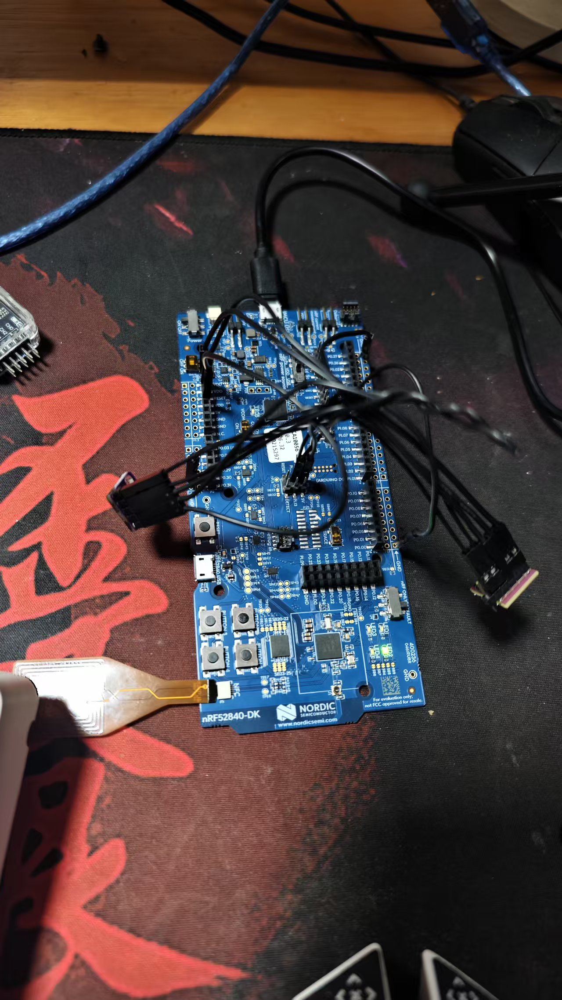
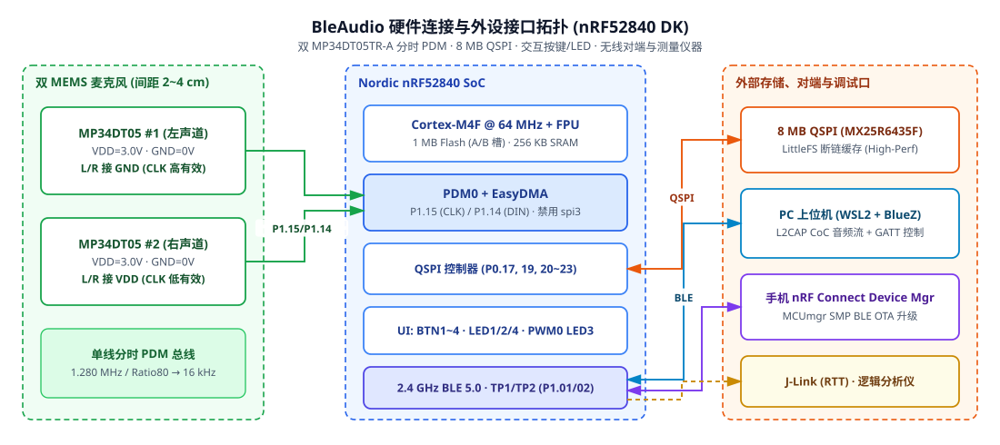
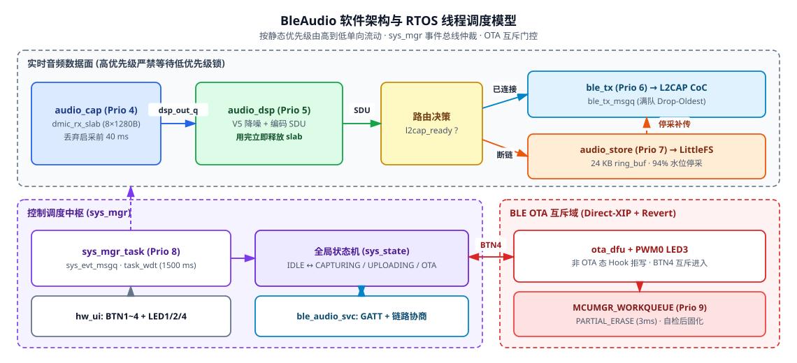
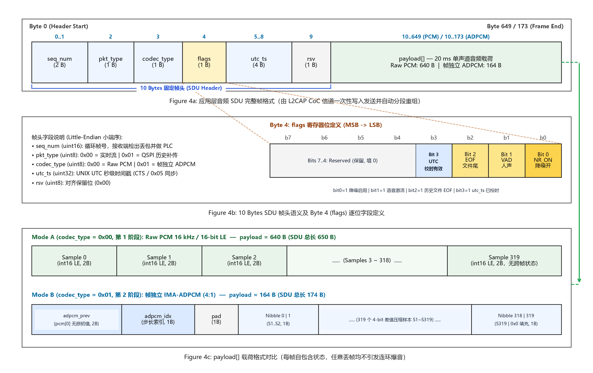
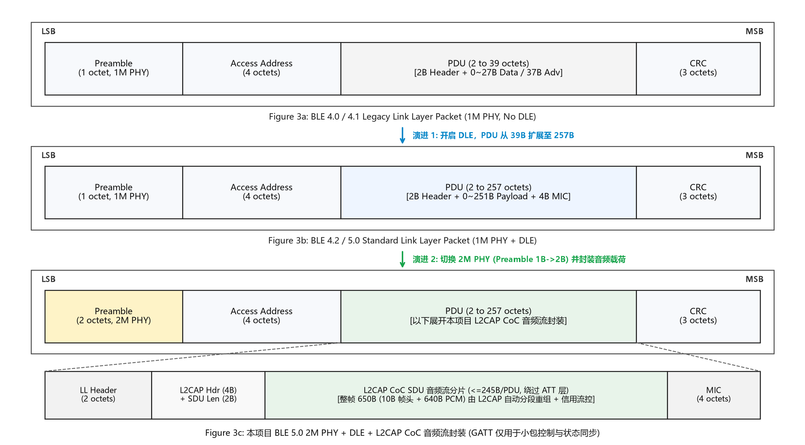
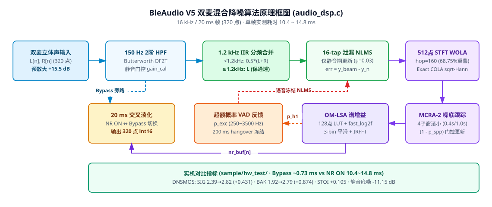
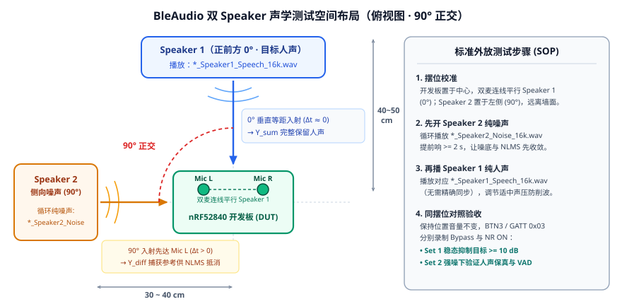
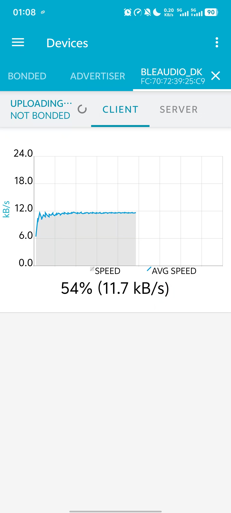
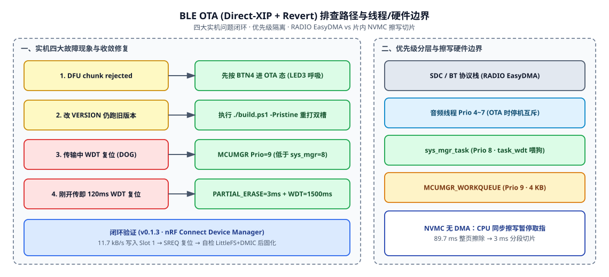

# BleAudio — 基于 nRF52840 DK 的双麦降噪与实时蓝牙音频方案

本项目采用 **V 字模型** 开发，基于 **Nordic nRF52840 DK** 开发板与 **nRF Connect SDK (v3.4.2)**，实现**双 MEMS 麦克风实时降噪采集**、**低功耗蓝牙实时音频流传输**、**板载 8 MB Flash 断链缓存与重连补传**，以及 **双槽防变砖无线升级（BLE OTA）**（当前固件基线：`v0.1.3`）。

---

## 1. 硬件实物与核心功能

### 1.1 实物样机

开发板通过顶部 J-Link USB 供电并输出调试日志；左右两侧接入两颗并排且朝向一致的数字 PDM MEMS 麦克风，仅用时钟与数据两根信号线即可采集立体声；左下角 4 个按键与指示灯负责启停、降噪切换和升级控制。

<p align="center">
  
</p>
<p align="center"><em>图 1：BleAudio 实机硬件连接图（nRF52840 DK 主板 + 双 MP34DT05TR-A 麦克风）</em></p>

### 1.2 核心功能一览

| 功能模块 | 实现能力与核心规格 | 按键与指示灯 |
| :--- | :--- | :--- |
| **双麦同步采集** | 精确采集 **16 kHz / 16-bit 立体声 PCM**（每 20 ms 一帧）；启动自动丢弃前 40 ms 瞬态，消除“咔嗒”爆音 | **BTN1** 短按：启停采集（**LED1** 指示） |
| **混合双麦降噪** | 低频双麦和波束 + 高频主麦直通保真 + 自适应噪声抵消 + 频域维纳谱抑制，单帧耗时 **10.4 ~ 14.8 ms** | **BTN3** 短按：切换降噪开关（**LED4** 指示） |
| **蓝牙实时传输** | 控制信令走 GATT，音频流走 **L2CAP CoC** 高速通道；支持 **Raw PCM (256 kbps)** 与 **帧独立 IMA-ADPCM (65.6 kbps)**；拥塞时自动丢弃最旧帧保实时性 | **LED2**：慢闪待连，常亮已连接 |
| **断链存储补传** | 蓝牙断开时音频无感转存板载 **8 MB QSPI Flash**；停采空闲期自动全速补传并清理；94% 满盘保护；补传时按 **BTN1** 可在 **0.21 ms** 内切回实时采集 | 支持上位机校时与按时间戳命名防覆盖 |
| **防变砖无线升级** | 采用 **Direct-XIP 双槽 + 自检回滚** 架构；非升级态拒绝写入；分段擦除防看门狗复位；新固件开机自检硬件正常后才固化 | **BTN4** 短按：停采集进入 OTA（**LED3** 呼吸灯） |

> **蓝牙传输速率说明**：固件支持 **2M PHY** 协商（仓库 `hci_usb/` 目录提供了配套 Dongle 2M 网卡固件）。本项目实测主要基于**商用 USB 蓝牙适配器（自动兼容降级为 1M PHY）**完成：**65.6 kbps ADPCM 实时流**与 **QSPI 离线全速补传（实测 63.7 KB/s 零丢包）** 均稳定通过；256 kbps Raw PCM 可用于短时对比录制，长稳高码率推流建议开启 ADPCM 或使用 `hci_usb` 启用 2M PHY。

---

## 2. 硬件原理与系统架构

### 2.1 硬件连接拓扑与芯片内部通路

两颗麦克风与片外 Flash、按键指示灯、无线对端共同接入主控芯片，整体板级连接如下图所示：

<p align="center">
  
</p>
<p align="center"><em>图 2：BleAudio 硬件连接与外设接口拓扑</em></p>

* **为什么两颗麦一个接 `GND`、一个接 `VDD`？**  
  两颗麦克风的电源脚都必须接 **3.0V**。图中的 `GND` 和 `VDD` 接的是**声道选择脚（L/R）**：左麦只在时钟高电平时输出，右麦只在低电平时输出，另一半周期均为高阻态，从而让**一根数据线分时传输左右双声道**。

为了看清片上外设如何在不占用 CPU 的前提下协同搬运数据，以及为什么 OTA 写固件时必须暂停录音，可以参考下面两张芯片内部框图与 PDM 采样时序图：

<p align="center">
  
</p>
<p align="center"><em>图 3：nRF52840 SoC 内部总线与外设结构框图</em></p>

* **芯片内部要点（图 3）**：麦克风采集（PDM）与蓝牙射频（RADIO）均通过独立的 **EasyDMA** 直接读写内存，几乎不消耗 CPU 算力；同时**片内 1 MB Flash**（运行程序，擦写会暂停 CPU 取指）与**片外 8 MB QSPI Flash**（存断链录音）总线物理隔离，互不干扰。

<p align="center">
  
</p>
<p align="center"><em>图 4：双路 MEMS 麦克风共用数据线的 PDM 分时采样时序</em></p>

* **PDM 时序要点（图 4）**：芯片输出 **1.280 MHz** 精确方波时钟，分别在时钟上升沿（左麦）与下降沿（右麦）采集 1-bit 脉冲，经过芯片内部 **80 倍硬件抽取滤波器**，直接输出零误差的 **16 kHz / 16-bit 交错立体声 PCM**（每 20 ms 形成 1280 B 数据块）。

---

### 2.2 软件架构与 RTOS 线程调度

系统按功能解耦为采集、降噪、蓝牙传输、本地存储和 OTA 五个模块，由状态机中枢统一协调：

<p align="center">
  
</p>
<p align="center"><em>图 5：BleAudio 软件模块解耦与 RTOS 静态优先级调度模型</em></p>

* **防卡顿设计**：线程优先级从采集（最高）向存储、OTA（最低）严格递减，高优先级音频线程绝不等待慢速 Flash 或蓝牙锁；无线拥塞时直接丢弃发送队列最旧帧，保证实时低延迟。
* **断链兜底策略**：录音期间若蓝牙就绪则全力推流，不并发读 Flash 抢带宽；断链时音频经 **24 KB 环形缓冲**写入外部 Flash，停采或触及 **94% 容量水位**后自动全速补传并清理已确认文件。

---

### 2.3 音频帧结构与蓝牙传输格式

为了防止无线丢包引发“连环爆音”，并规避 nRF52840 不支持经典蓝牙语音（HFP）和新一代等时音频（LE Audio CIS）的硬件限制，本项目在应用层与链路层做了针对性设计：

<p align="center">
  
</p>
<p align="center"><em>图 6：每 20 ms 一帧的应用层音频数据包结构</em></p>

* **丢包不连环爆音（图 6）**：每帧自带 10 字节帧头（含递增序号、实时/补传标识、编码格式、降噪/人声状态与时间戳）。开启 **4:1 IMA-ADPCM 压缩**时，每帧头部强制嵌入该帧首样本的解码基准状态，使**每一帧都能完全独立解码**，中途丢帧后下一帧到达即可立即恢复音质。

<p align="center">
  
</p>
<p align="center"><em>图 7：BLE 5.0 链路层长包（251 B）与 L2CAP 分片传输格式</em></p>

* **为什么选 L2CAP CoC（图 7）**：普通蓝牙特征值通知（GATT Notify）开销大且缺乏流控，仅用来传递启停、降噪开关、校时等小包控制指令；音频流直接走 **L2CAP 面向连接流通道**，应用层写入整帧 650 B 音频后由协议栈自动按 **251 B 长包**分段发射，并自带信用流控防止冲垮接收端。

---

## 3. 降噪算法原理（V5 混合降噪架构）

在 **64 MHz Cortex-M4F** 的有限算力预算（每帧 20 ms）内，算法经过 5 轮实机迭代，最终形成 **“分频双麦合并 + 静音门控自适应抵消 + 高重叠频域谱增强”** 流水线：

<p align="center">
  
</p>
<p align="center"><em>图 8：BleAudio V5 双麦混合降噪算法原理框图</em></p>

1. **公平预处理**：开启降噪与旁路模式共享相同的 **+15.5 dB 预放大** 与 **150 Hz 二阶高通滤波**，先滤除空调低频轰鸣与桌面震动，确保实测对比客观公平。
2. **1.2 kHz 分频合并（解决人声发闷）**：低频段（< 1.2 kHz）波长远大于麦距，两麦同相相加抑制风噪与电路自噪；高频段（≥ 1.2 kHz）平滑切回主麦直通，彻底消除双麦声程差带来的相位抵消，保住 **1.5–4 kHz** 人声清亮度。
3. **静音门控自适应抵消（16 阶 NLMS）**：仅在语音检测（VAD）判定为纯静音时缓慢更新滤波器权值抵消低频相关噪声；一旦检测到人声立刻冻结权值，防止误消目标语音。
4. **高重叠频域降噪（512 点 MCRA-2 + OM-LSA）**：采用 **68.75% 高重叠加窗变换**消除早期 `100 Hz` 周期电流调制感，配合旁路期间持续预填充消除开启前 10 秒闪烁；通过 4 子窗滚动最小追踪动态分离人声谐波与环境噪底，并利用查找表与快速浮点近似把单帧算力压到 **10.4 ~ 14.8 ms**。

---

## 4. 硬件资源使用与引脚分配

### 4.1 存储、内存与算力实测占用（`v0.1.3` 构建实测）

| 资源维度 | 硬件总容量 / 分区 | 实测占用 | 关键说明 |
| :--- | :--- | :--- | :--- |
| **片内 Flash** | **1 MB**（原生标准分区：<br>引导 48 KB + A/B 槽各 472 KB + 参数 32 KB） | 应用固件 **353 KB**（占单槽 **74.8%**）<br>Bootloader **26 KB** | 原地双槽切换（Direct-XIP），无需搬运等待 |
| **片内 SRAM** | **256 KB**（全静态分配，零动态申请） | **191.4 KB**（占 **74.8%**）<br>剩余安全余量 **64.6 KB** | 含蓝牙协议栈与缓冲 ~100 KB、外部存储缓存 ~39 KB、降噪上下文 ~30 KB、DMA 帧池 10 KB、5 个任务栈 16 KB |
| **片外 QSPI** | **8 MB**（LittleFS 文件系统） | **94%** 满盘水位保护 | 开启 Flash 高性能模式与 4 KB 缓存，Raw PCM 可存 **3.5 ~ 3.8 分钟** |
| **CPU 算力** | Cortex-M4F @ 64 MHz (带 FPU) | 旁路模式 **~0.73 ms** / 帧<br>降噪模式 **10.4 ~ 14.8 ms** / 帧 | 20 ms 帧预算内留有充足余量，全程 **零丢帧** |

### 4.2 关键硬件引脚与避让说明

| 外设功能 | 使用引脚 | 工程避让与注意要点 |
| :--- | :--- | :--- |
| **双路 PDM 麦克风** | `P1.15` (时钟), `P1.14` (数据) | 设备树禁用默认冲突的板载 `spi3` 与 `i2c0` |
| **4 个板载按键** | `P0.11`, `P0.12`, `P0.24`, `P0.25` | 30 ms 软件消抖（采集 / 预留 / 降噪 / OTA） |
| **3 个常规状态灯** | `P0.13`, `P0.14`, `P0.16` | 分别指示采集、蓝牙连接、降噪/异常告警 |
| **OTA 呼吸灯 (LED3)** | `P0.15` (PWM 输出) | 关闭 Nordic DK 库以防与 GPIO 驱动冲突 |
| **逻辑分析仪测延迟脚** | `P1.01`, `P1.02` | 用于实测采集完成到蓝牙入队的内部耗时 |

---

## 5. 测试方法与实测结果

### 5.1 声学、存储与 OTA 测试方法

1. **标准化声学测试方法（[`sample/`](sample/README.md) & [`tools/`](tools/README.md)）**：  
   使用基于 **ITU-T P.501** 构建的 16 kHz 标准人声与办公室/地铁噪声素材，按下图两种摆位外放测试（噪声提前 2 秒起播以待噪底收敛），同条件下按 `BTN3` 分别录制降噪关闭（Bypass）与开启（NR ON）对比音频：

<p align="center">
  
  &nbsp;&nbsp;
  
</p>
<p align="center"><em>图 9：双 Speaker 90° 正交测试布局（左）与单 Speaker 旋转测试方法（右）</em></p>

   通过上位机接收并自动生成客观量化对比报告：
   ```bash
   # 1. WSL2 + BlueZ 上位机接收 WAV（按帧头标志自动拆出 Bypass 与 NR ON 两轨）
   python3 tools/ble_audio_recv.py -o tools/test_pcm.wav

   # 2. 运行标准化评测脚本（自动计算 DNSMOS / SQUIM / Silero VAD / 响度与频谱）
   python tools/generate_acoustic_plots.py sample/hw_test/test_pcm_bypass.wav sample/hw_test/test_pcm_nr.wav --labels "Bypass" "NR ON" -o sample/assets/hw_test_compare.png
   ```

2. **存储与 OTA 验证**：通过串口/RTT 实时日志监控断链写入丢帧数、抢占响应耗时及系统复位原因；使用手机端 **nRF Connect Device Manager** 下发升级包验证 OTA 速度、非升级态拦截及回滚机制。

---

### 5.2 降噪效果实测对比

实机对比样本已保存于 [`sample/hw_test/test_pcm_bypass.wav`](sample/hw_test/test_pcm_bypass.wav) 与 [`sample/hw_test/test_pcm_nr.wav`](sample/hw_test/test_pcm_nr.wav)。从图 10 的对比图谱可以直观看到：降噪开启后，语音停顿间的噪声能量显著压平，语谱图干净无周期性电流纹波；同响度对齐下，`1.5–4 kHz` 人声核心清晰度频段保持贴合不发闷，而静音段宽带底噪整体下降 **10–20 dB**。

<p align="center">
  
</p>
<p align="center"><em>图 10：实机 Bypass vs NR ON 波形、语谱图、功率谱密度与客观 MOS 对比图谱</em></p>

| 评测维度 | 关键指标 | 旁路 (Bypass) | 降噪 (NR ON) | 提升幅度 |
| :--- | :--- | :---: | :---: | :---: |
| **DNSMOS P.835** | 人声保真度 (`SIG`) | `2.389` | **`2.820`** | **`+0.431 MOS`** |
| **DNSMOS P.835** | 背景干净度 (`BAK`) | `1.919` | **`2.793`** | **`+0.874 MOS`** |
| **DNSMOS P.835 / P.808** | 综合听感 (`OVRL` / `P.808`) | `1.684` / `2.576` | **`2.104` / `2.736`** | **`+0.420` / `+0.160`** |
| **Meta SQUIM** | 可懂度 (`STOI`) / 质量 (`PESQ`) | `0.671` / `1.183` | **`0.776` / `1.358`** | **`+0.105` / `+0.175`** |
| **Meta SQUIM** | 信噪失真比 (`SI-SDR`) | `+2.832 dB` | **`+4.384 dB`** | **`+1.552 dB`** |
| **Silero VAD** | 静音底噪 / 语噪对比度 | `-40.00` / `+8.06 dB` | **`-51.15` / `+15.43 dB`** | **底噪降 `11.15 dB`** |

---

### 5.3 断链存储与补传实测结果

* **高速写盘零丢帧**：开启外部 Flash 高性能模式与 4 KB 页缓存对齐后，连续离线录音 57 秒（2,845 帧 / 1.85 MB）**丢帧数为 0**，停采后 107 ms 完成刷盘封口。
* **全速补传与即时抢占**：商用 `1M PHY` 下完整补传 2,845 帧耗时约 29.1 秒（约 **63.7 KB/s**）零丢包；补传过程中按下 `BTN1`，仅用 **0.21 ms** 即中断补传并切回实时录音，停采后自动续传剩余数据。
* **满盘水位保护**：连续离线录制 4 分钟（12,051+ 帧 / 7.88 MB，零丢帧）触及 **94%** 水位后，在 **2 ms** 内强制安全停采并封口文件。

---

### 5.4 无线 OTA 升级实测结果

按下 `BTN4` 进入升级模式后，通过手机端 **nRF Connect Device Manager** 实测无线传包速率稳定在 **11.7 kB/s**（约 12.3 秒传完新槽位，如图 11），重启后直接从新槽位运行并完成外部存储与麦克风自检固化。图 12 汇总了开发期解决的 4 个典型问题（重点通过降低 OTA 任务优先级与开启 **3 ms 分段擦除**，彻底解决了片内 Flash 擦除耗时过长导致的看门狗复位）。

<p align="center">
  
</p>
<p align="center"><em>图 11：手机端无线 OTA 升级实测截图（速率 11.7 kB/s）</em></p>

<p align="center">
  
</p>
<p align="center"><em>图 12：BLE OTA 四大实测故障排查闭环与硬件擦写边界</em></p>

---

## 6. 工程目录与编译烧录

```text
BleAudio/
├── README.md        # 项目总览与实测说明书
├── assets/          # 实物照片、OTA 截图及 draw.io 原理/架构图
├── firmware/        # 基于 NCS v3.4.2 的嵌入式固件工程 (v0.1.3)
├── tools/           # 上位机 L2CAP 接收脚本与声学评测脚本 (见 tools/README.md)
├── sample/          # ITU-T P.501 基准测试音频与实机对比样本 (见 sample/README.md)
├── hci_usb/         # 可选：BT5040U Dongle 2M PHY 网卡固件与 WSL2 指南
└── doc/             # V 字模型全套工程设计、接口与验证文档 (.docx)
```

在安装好 **nRF Connect SDK (v3.4.2)** 的终端下执行编译与烧录（修改版本号或设备树后务必带 `-Pristine` 参数重新打包双槽升级包）：

```powershell
cd firmware
./build.ps1 -Pristine   # 输出合并固件与双槽升级包 firmware/build/dfu_application.zip
west flash              # 烧录出厂固件
```

---

## 7. V 字模型全套工程文档 (`doc/`, `.docx`)

| 类别 | 文档名称 | 核心内容 |
| :--- | :--- | :--- |
| **需求与架构** | [01_产品需求规格说明书_PRD.docx](doc/01_需求与验收/01_产品需求规格说明书_PRD.docx) | 功能边界、验收标准与非功能指标 |
| **需求与架构** | [02_系统架构与调度设计_SDS.docx](doc/02_系统架构/02_系统架构与调度设计_SDS.docx) | 模块解耦、状态机、DMA 与任务优先级 |
| **功能域详设** | [01_音频采集降噪与格式转换详设.docx](doc/03_功能域详设/01_音频采集降噪与格式转换详设.docx) | PDM 采样推导、V5 降噪算法与帧独立编码 |
| **功能域详设** | [02_蓝牙协议栈与L2CAP传输详设.docx](doc/03_功能域详设/02_蓝牙协议栈与L2CAP传输详设.docx) | 链路协商、L2CAP 流控与拥塞丢帧策略 |
| **功能域详设** | [03_BLE_OTA与防变砖升级详设.docx](doc/03_功能域详设/03_BLE_OTA与防变砖升级详设.docx) | Direct-XIP + Revert 机制与防复位设计 |
| **功能域详设** | [04_内存与存储管理详设.docx](doc/03_功能域详设/04_内存与存储管理详设.docx) | Flash 分区、QSPI 高性能写入与 SRAM 分配 |
| **硬件与接口** | [01_硬件接口与设备树配置规范.docx](doc/04_硬件与设备树/01_硬件接口与设备树配置规范.docx) | 引脚分配、外设避让、设备树与配置 |
| **硬件与接口** | [01_软件API与BLE通信协议_ICD.docx](doc/05_通信与模块接口/01_软件API与BLE通信协议_ICD.docx) | 模块头文件契约与蓝牙通信字节协议 |
| **验证与报告** | [01_V模型测试计划与追溯矩阵_VTP.docx](doc/06_V字测试与验证/01_V模型测试计划与追溯矩阵_VTP.docx) | UT / IT / ST / AT 用例与需求追溯矩阵 |
| **验证与报告** | [02_Phase2_QSPI存储与补传调试排查记录.docx](doc/06_V字测试与验证/02_Phase2_QSPI存储与补传调试排查记录.docx) | QSPI 写盘优化、WSL2 排查与抢占实证 |
| **验证与报告** | [03_Phase3_音频采集与降噪算法调试演进报告.docx](doc/06_V字测试与验证/03_Phase3_音频采集与降噪算法调试演进报告.docx) | 硬件双麦排查、V1→V5 演进对比与资源实证 |
| **验证与报告** | [04_Phase1_BLE_OTA调试排查记录.docx](doc/06_V字测试与验证/04_Phase1_BLE_OTA调试排查记录.docx) | OTA 四大问题定位、日志与构建实证 |
