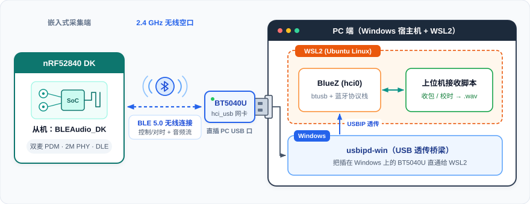
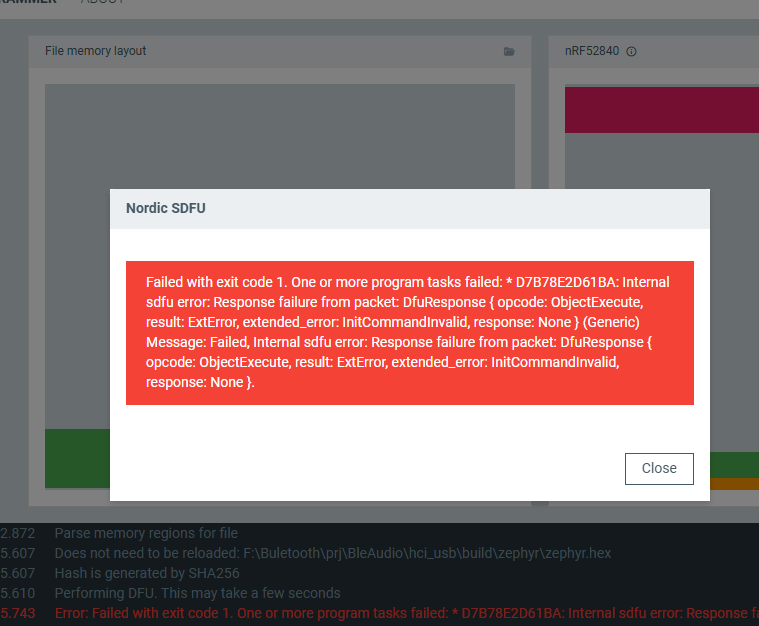
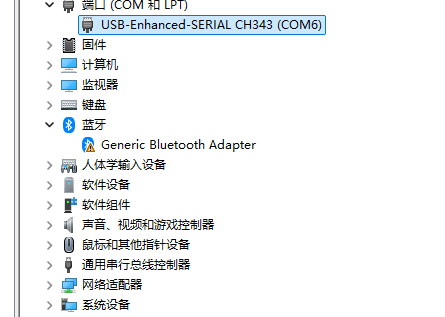
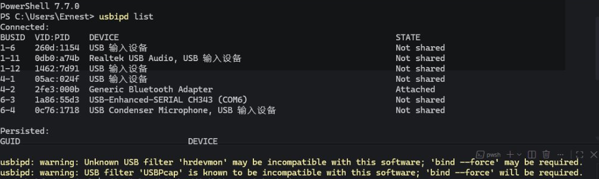
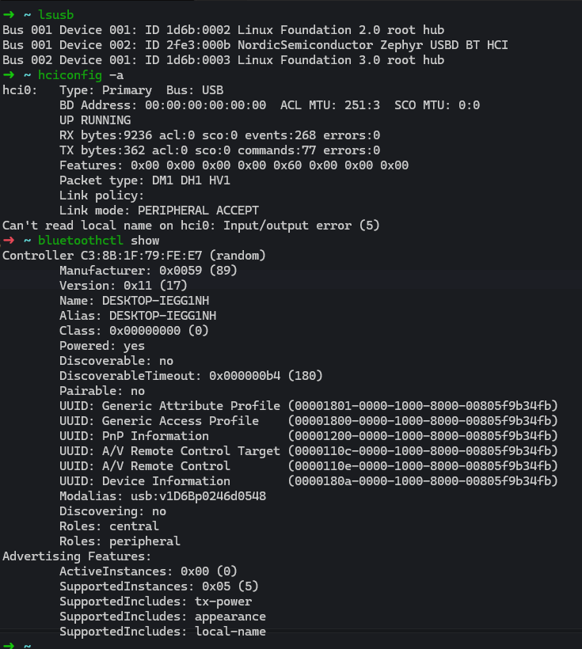
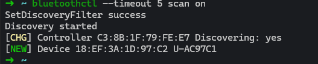

# BT5040U (`hci_usb`) 环境搭建与使用说明

这个目录用来把 **亿佰特 E104-BT5040U**（硬件和 Bootloader 兼容 Nordic 官方 `nRF52840 Dongle / PCA10059`）刷成一块通用的 USB 蓝牙网卡，插在电脑上转接进 **WSL2（Ubuntu）**，给 `BleAudio` 的上位机用来接收开发板的无线音频。先看一眼整体是怎么连起来的：



顺便说下为什么这么折腾，而不直接用 Windows 自带蓝牙或官方例程：
- Windows 原生蓝牙接口不开放底层的 **L2CAP CoC 高速数据通道**，而我们的音频流恰恰走这条通道，所以把接收端放在 WSL2 的 Linux 蓝牙协议栈里最顺手。
- BT5040U 买来默认要么只带了个引导程序（Open Bootloader），要么刷着抓包用的 Sniffer 固件，没法直接当成蓝牙设备去连开发板。
- Zephyr 官方自带的 `hci_usb` 例程默认单包只能发 27 字节，带不动我们一帧 650 字节的音频数据，所以得打开 2M 高速模式并把单包上限放宽到 251 字节。

如果你用的也是 BT5040U（或者官方 PCA10059 Dongle），**不用装几个 G 的 SDK 重新编译**，我把编好的固件包直接放在目录里的 [bt5040u_hci_usb.zip](bt5040u_hci_usb.zip) 了，照着下面步骤刷进去、挂到 WSL2 就能用。

---

## 目录文件说明

```text
hci_usb/
├── bt5040u_hci_usb.zip   # 编译打包好的固件，直接拿去刷就行
├── prj.conf              # 改过 2M 高速模式 / 251 字节大包 / 缓冲深度的配置
├── CMakeLists.txt / Kconfig / src/main.c
└── assets/               # 实操截图和链路图
```

BT5040U 刷完这个固件以后，在系统里的角色就相当于插在电脑上的 **USB 无线网卡**，只管老老实实收发无线信号。至于怎么去搜 `BLEAudio_DK`、对时、控制录音和把音频存成 `.wav`，全由 WSL2 里的蓝牙协议栈和上位机脚本负责，Dongle 本身不用再动任何代码。

---

## 1. 给 BT5040U 刷入固件

### 1.1 准备 `nrfutil`

刷固件要用到 Nordic 的 `nrfutil` 命令行工具。如果你电脑上装过 **nRF Connect for Desktop** 或 NCS 工具链，它一般已经自带在 `%USERPROFILE%\.nrfutil\bin\nrfutil.exe` 了（在 nRF Connect for VS Code 终端里也能直接敲）；如果普通 PowerShell 提示找不到命令，可以把那个路径加进环境变量 `PATH`，或者去 Nordic 官网下一个 `nrfutil.exe`。

第一次用先装上烧录组件（`device` 用来顺手查串口号，懒得装的话直接去设备管理器看端口号也行）：

```powershell
nrfutil install nrf5sdk-tools
nrfutil install device
```

> **别用桌面版 `nRF Connect Programmer`（v4.8.x）来烧**  
> 我踩过这个坑：新版 Programmer 拖入 `.zip` 压缩包时 `Write` 按钮是灰的；如果改拖 `.hex`，它自动生成的固件校验信息格式和板子自带的 Bootloader 对不上，会直接拒收报错（如下图）：
>
> 
>
> 直接用命令行 `nrfutil` 刷现成的 `.zip` 就行，省事很多。

### 1.2 让板子进入刷机模式（红灯呼吸）

1. 如果 BT5040U 外面套着那层蓝色塑料壳，从侧边卡扣轻轻掰开就能取下来，按键都在里面。
2. 插到电脑 USB 上通电，按一下侧边的 **`RST` 复位键**（规格书第 36 号脚位）。
   - 如果你手上的板子没焊 `RST` 按键，可以先拔掉，**按住旁边的 `SW` 键不松手再插回 USB**；要是两个按键都没焊，通电状态下用金属镊子把背面 `V R D C G` 五个焊盘里的 **`R` 和 `G`（或者 USB 金属壳）轻碰一下松开**也能触发复位。
3. 看到板子上 **红灯开始一呼一吸地闪烁**，就说明进去了。跑一下 `nrfutil device list`（或在设备管理器的“端口”下面找 `nRF52 SDFU USB`），记下它的串口号（比如 `COM5`）。

### 1.3 命令行烧录

确认没有别的软件（Programmer、串口助手之类的）占着这个串口，在 **`hci_usb/` 目录**下执行（把 `COM5` 换成你电脑上显示的端口号）：

```powershell
nrfutil nrf5sdk-tools dfu usb-serial -pkg bt5040u_hci_usb.zip -p COM5
```

进度条走到 100% 后红灯会熄灭，Dongle 自动重启。

这时候去 Windows 设备管理器看，“蓝牙”下面会多出一个带黄色感叹号的 **`Generic Bluetooth Adapter`**：



看到这个不用慌，也不要在 Windows 里找驱动装。因为 nRF52840 只支持低功耗蓝牙（BLE），不支持传统经典蓝牙，Windows 默认按传统蓝牙去识别它，自检过不去就会标感叹号。反过来讲，看到它出现其实就说明固件已经正常跑起来了，接下来交给 WSL2 就行。

*（补充：如果以后需要拿这根 Dongle 切回 Wireshark 抓包，同样按 `RST` 进红灯呼吸，用同一条命令把 Sniffer 固件的 `.zip` 刷回去即可。）*

---

## 2. 配置 WSL2 并把 Dongle 挂进去

### 2.1 Windows 安装 `usbipd-win`

在 PowerShell 里安装 USB 透传工具：

```powershell
winget install --exact dorssel.usbipd-win
```

装完以后**关掉当前窗口，重新以管理员身份开一个新的 PowerShell**，不然找不到 `usbipd` 命令。

### 2.2 在 WSL2（Ubuntu）里安装蓝牙工具

现在的 WSL2 内核基本都已经自带蓝牙驱动了，不用折腾编译内核，直接在 Ubuntu 里装上蓝牙管理工具就行：

```bash
sudo apt update && sudo apt install -y bluez usbutils
```

### 2.3 把 BT5040U 转接给 WSL2

保持 Ubuntu 终端开着，切到**管理员 PowerShell**：

```powershell
usbipd list
# 找一下 Generic Bluetooth Adapter 那一行的 BUSID，比如 4-2

usbipd bind --force --busid 4-2
usbipd attach --wsl --busid 4-2
```

执行完再敲一遍 `usbipd list`，状态变成 `Attached` 就对了：



> **两个常见小坑提醒**  
> 1. **为什么要加 `--force`？** 看图最下面那两行黄色警告：只要电脑装过 Wireshark（`USBPcap`）或火绒（`hrdevmon`），不加 `--force` 经常会出现“假挂载”——Windows 这边显示 `Attached`，进 Ubuntu 跑 `lsusb` 却什么都没有。如果卡在假挂载状态，先依次执行 `usbipd detach --busid <BUSID>` 和 `usbipd unbind --busid <BUSID>` 清一下，再重新 `bind --force` + `attach --wsl`。  
> 2. **重启或拔插后需要重新挂一下**：`bind` 是永久保存的，但 `attach --wsl` 只要拔插过 Dongle、关闭过 WSL 或重启过电脑就会断开。下次开机发现 Ubuntu 里找不到蓝牙网卡时，重新跑一遍 `usbipd attach --wsl --busid <BUSID>`（也可以在后面加 `--auto-attach` 让它自动重挂）。如果全新开的 WSL2 首次 `attach` 提示 `vhci_hcd` 模块未加载，先在 Ubuntu 里跑一句 `sudo modprobe vhci-hcd` 再回来挂载。

### 2.4 在 Ubuntu 里拉起蓝牙并自检

回到 Ubuntu 终端：

```bash
sudo modprobe vhci-hcd
sudo modprobe btusb
sudo service bluetooth start

lsusb
hciconfig -a
bluetoothctl show
```

*(如果精简版系统里 `service bluetooth start` 提示 D-Bus 没起来，先跑一句 `sudo service dbus start` 再试。)*

正常的话会看到下面这几项：
- `lsusb`：能看到 `NordicSemiconductor Zephyr USBD BT HCI`；
- `hciconfig -a`：状态是 `UP RUNNING`，而且写着 **`ACL MTU: 251:3`**（`251` 说明大包模式生效了）；
- `bluetoothctl show`：打印出一个带 `(random)` 的蓝牙地址，且 `Powered: yes`。



图里有两处看着像报错的地方其实正常，不用在意：一是 `hciconfig` 提示 `Can't read local name...`，因为这个芯片没有传统蓝牙名字；二是上面 `BD Address` 显示全 `00:00...`，以后面 `bluetoothctl show` 打出来的 `Controller ... (random)` 地址为准就行。

最后跑一下 `bluetoothctl --timeout 5 scan on`，能扫到周围蓝牙设备就大功告成了：



---

## 3. 联调自测工具（可选）

走到这里，接收端的底层环境就已经全部通了。如果想了解上位机脚本后续会用到哪些控制命令和音频包格式，可以对照主仓库的设计文档 [02_蓝牙协议栈与L2CAP传输详设.docx](../doc/03_功能域详设/02_蓝牙协议栈与L2CAP传输详设.docx) 和 [01_软件API与BLE通信协议_ICD.docx](../doc/05_通信与模块接口/01_软件API与BLE通信协议_ICD.docx)。

在上位机接收脚本还没写完之前，前面装好的 `bluez` 已经带了几个好用的命令行工具，调开发板时可以直接拿来摸底：

- **扫广播、试连开发板（`bluetoothctl`）**：
  ```bash
  bluetoothctl
  # 进去后依次敲：scan on -> connect <开发板蓝牙地址>
  # 连上后可以进 menu gatt -> list-attributes 看一下服务是否都注册出来了
  ```
- **直接测音频通道通不通（`l2test`）**：
  ```bash
  sudo l2test -u -V le_random -P 0x0080 -I 650 <开发板蓝牙地址>
  ```
- **抓底层蓝牙日志（`btmon`）**：
  ```bash
  # 另开一个 Ubuntu 终端跑，能看有没有成功切到 2M 高速模式，也能导出给 Wireshark 分析
  sudo btmon -w ble_debug.btsnoop
  ```
- **无线升级（BLE OTA）**：给开发板无线升固件时，可以直接用手机上的 **nRF Connect Device Manager** 发送编译出来的 `dfu_application.zip`。

等后面用接收脚本把音频存成 `.wav` 之后，回到**仓库根目录**就能用自带脚本画波形和频谱对比图（需要当前 Python 环境装有 `numpy` 和 `matplotlib`）：

```powershell
python sample/generate_acoustic_plots.py bypass.wav nr_on.wav --labels "Bypass" "NR ON" -o compare.png
```

---

## 附录：改配置后如何自己重新编译（一般用不到）

相比 Zephyr 原版 `hci_usb`，我只改了 [prj.conf](prj.conf)：把单包收发大小从默认 27 字节拉到 251 字节、开启 2M 高速模式、加大了缓冲队列深度（事件接收缓冲必须设得比发送缓冲大，所以分别设了 16 和 12，否则编译会报错），并把单次蓝牙连接窗口放宽到 15 ms，确保高码率传输不断流（默认发射功率为 `0 dBm`，桌面近距离够用；如果需要拉远距离可以把功率改到 `+8 dBm`）。

如果之后你想改配置重编，打开 **nRF Connect for VS Code 终端**（或 NCS 工具链终端），基于 **nRF Connect SDK v3.4.2** 在 `hci_usb/` 目录下执行：
1. 开发板目标务必选 **`nrf52840dongle/nrf52840`**（别选成 `nrf52840dk` 或 `.../bare`，因为 Dongle 自带 Bootloader 需要留出开头空间和特定供电配置，选错了烧进去会跑飞），Sysbuild 选 **No sysbuild**。
2. 编译并打包成可刷写的 `.zip`：
   ```powershell
   west build -b nrf52840dongle/nrf52840 --no-sysbuild --pristine

   nrfutil nrf5sdk-tools pkg generate `
     --hw-version 52 `
     --sd-req 0x00 `
     --application build/zephyr/zephyr.hex `
     --application-version 1 `
     bt5040u_hci_usb.zip
   ```
