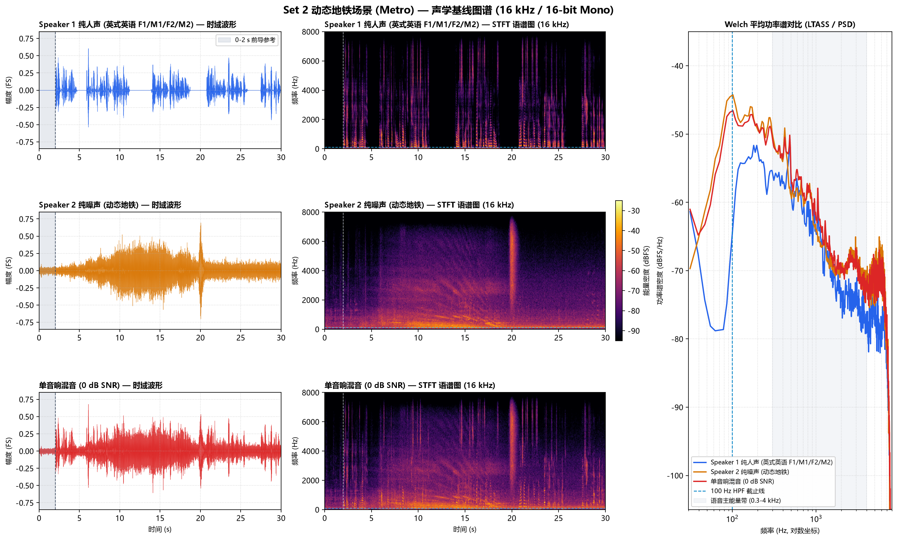
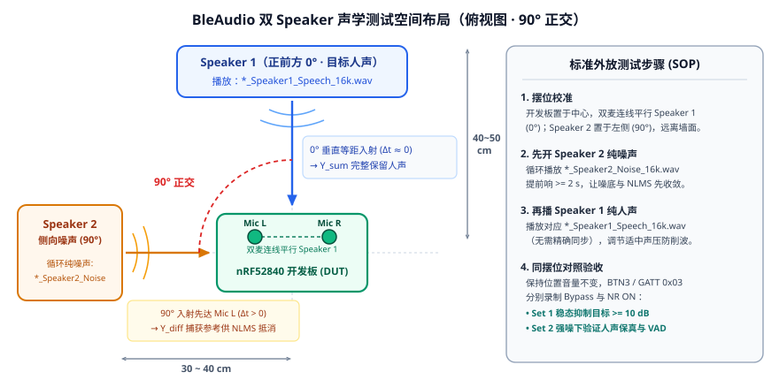

# BleAudio 基准测试音频与声学基线 (`sample/`)

本目录存放用于 BleAudio 双麦采集与降噪验证的标准输入音频（基于 ITU-T P.501 标准语料构建，全部统一为 **`16 kHz / 16-bit / 单声道 PCM`**、时长 **`30.00 s`**、零削波），以及通用声学分析绘图脚本和基线图谱。

---

## 1. 目录结构

```text
sample/
├── README.md                          # 本文件：声学基线参数、图谱与实测方法
├── generate_acoustic_plots.py         # 通用音频声学分析与基线图谱绘制脚本 (Python)
├── assets/                            # 基准声学分析图谱与测试示意图
│   ├── set1_office_baseline.png       # Set 1 稳态办公室：波形 / 语谱图 / PSD
│   ├── set2_metro_baseline.png        # Set 2 动态地铁：波形 / 语谱图 / PSD
│   ├── snr_envelope_comparison.png    # 20 ms 短时能量包络与动态 SNR 轨迹
│   ├── test_spatial_setup.svg         # 双 Speaker 90° 正交外放测试空间布局示意图 (SVG 矢量)
│   └── test_single_speaker_setup.svg  # 单 Speaker 测试空间摆位与旋转验收示意图 (SVG 矢量)
├── dual_speaker/                      # 双 Speaker 空间外放套件 (4 个文件)
│   ├── Set1_Office_Speaker1_Speech_16k.wav
│   ├── Set1_Office_Speaker2_Noise_16k.wav
│   ├── Set2_Metro_Speaker1_Speech_16k.wav
│   └── Set2_Metro_Speaker2_Noise_16k.wav
└── single_speaker/                    # 单 Speaker 链路对照 / 离线仿真套件 (2 个文件)
    ├── Single_Office_+5dB_16k.wav
    └── Single_Metro_0dB_16k.wav
```

---

## 2. 音频规格与客观基线参数

> **统一格式**：`16,000 Hz` 采样率、`16-bit` 有符号整数 PCM、单声道（1 ch）、`30.00 s`（`480,000` samples）。  
> 原始 `48 kHz` ITU 素材均经 127 阶线性相位 Kaiser 抗混叠低通滤波（`fc = 7000 Hz`, `beta = 8.6`）后严格 3:1 降采样。

### 2.1 双 Speaker 空间外放套件 (`dual_speaker/`)

| 场景套组 | 播放端 | 文件名 | 素材来源 (ITU-T P.501) | 总 RMS (dBFS) | 活跃/底噪 RMS (dBFS) | 峰值 (dBFS) | `0–2 s` 前导 | `<100 Hz` 能量占比 | `0.3–4 kHz` 能量占比 |
| :--- | :--- | :--- | :--- | :---: | :---: | :---: | :---: | :---: | :---: |
| **Set 1 办公室** | `Speaker 1` (`0°`) | [`Set1_Office_Speaker1_Speech_16k.wav`](dual_speaker/Set1_Office_Speaker1_Speech_16k.wav) | `American English B.3.4` (`F1/M1/F2/M2`) | `-27.53` | `-24.25` | `-3.38` | 纯静音 (`-240 dB`) | `2.1%` | `84.0%` |
| **Set 1 办公室** | `Speaker 2` (`90°`) | [`Set1_Office_Speaker2_Noise_16k.wav`](dual_speaker/Set1_Office_Speaker2_Noise_16k.wav) | `off_mono1_30s` (稳态办公室，注 1) | `-26.53` | `-26.53` | `-2.37` | `-26.86 dBFS` | `11.0%` | `47.6%` |
| **Set 2 地铁** | `Speaker 1` (`0°`) | [`Set2_Metro_Speaker1_Speech_16k.wav`](dual_speaker/Set2_Metro_Speaker1_Speech_16k.wav) | `English_FB B.3.3` (`f1/m1/f2/m2`) | `-26.67` | `-24.27` | `-4.31` | 纯静音 (`-240 dB`) | `6.5%` | `57.0%` |
| **Set 2 地铁** | `Speaker 2` (`90°`) | [`Set2_Metro_Speaker2_Noise_16k.wav`](dual_speaker/Set2_Metro_Speaker2_Noise_16k.wav) | `met_mono1_30s` (动态地铁) | `-21.99` | `-21.99` | `-3.10` | `-34.38 dBFS` | `11.6%` | `31.8%` |

> **注 1**：[`Set1_Office_Speaker2_Noise_16k.wav`](dual_speaker/Set1_Office_Speaker2_Noise_16k.wav) 为 100% 保留 ITU 原生波形特征，在约 `24.8 s` 处自带一记短促办公室敲击瞬态尖峰（导致实测峰值 `-2.37 dBFS` / Crest `24.16 dB`），其余时段均保持平稳底噪。

### 2.2 单 Speaker / 离线仿真套件 (`single_speaker/`)

| 场景 | 文件名 | 合成基准与标定 SNR | 总 RMS (dBFS) | 峰值 (dBFS) | 峰值因子 (Crest) | `0–2 s` 纯噪声前导 | `<100 Hz` 能量占比 | `0.3–4 kHz` 能量占比 |
| :--- | :--- | :--- | :---: | :---: | :---: | :---: | :---: | :---: |
| **常规稳态** | [`Single_Office_+5dB_16k.wav`](single_speaker/Single_Office_+5dB_16k.wav) | Set 1 人声 + 办公室噪声 (**`+5.00 dB`**) | `-25.32` | `-3.20` | `22.12 dB` | `-29.58 dBFS` | `5.7%` | `69.4%` |
| **严苛动态** | [`Single_Metro_0dB_16k.wav`](single_speaker/Single_Metro_0dB_16k.wav) | Set 2 人声 + 动态地铁噪声 (**`0.00 dB`**) | `-22.31` | `-3.33` | `18.99 dB` | `-36.66 dBFS` | `9.8%` | `41.3%` |

---

## 3. 声学基线图谱

### 3.1 Set 1 — 稳态办公室场景 (`Office`)


* **基准特征**：
  * **时域波形**：前 `0–2 s` 人声轨为纯零静音（混音轨为纯噪声），为固件端 `noise_floor_ema` 与 32 阶 NLMS 提供充分收敛前导；第 `2–30 s` 均匀分布 `F1 / M1 / F2 / M2` 四位说话人句段，活跃声压稳定在 `-24.25 dBFS`。
  * **语谱图 & Welch PSD**：人声 `84.0%` 能量集中在 `0.3–4 kHz` 语音主频带，谐波与共振峰清晰；办公室噪声频谱在 `100 Hz–2 kHz` 平坦稳定，是验证 **`>= 10 dB` 稳态抑制** 的理想参考。

### 3.2 Set 2 — 动态地铁场景 (`Metro`)



* **基准特征**：
  * **强非稳态起伏**：地铁噪声在前 `0–5 s` 较轻（约 `-34 dBFS`），中段 `10–18 s` 列车进站时底噪骤升，约 `20 s` 处存在宽带瞬态冲击。
  * **低频结构对比**：`met_mono1_30s` 在 `100 Hz` 附近有显著低频隆隆声峰值（`< 100 Hz` 占总功率 `11.6%`），可直接体现固件端 **100 Hz 一阶高通滤波器 (HPF)** 的低频削减效果。

### 3.3 20 ms 帧能量包络与动态 SNR 轨迹


* **判读要点**：
  * **Set 1 (`+5 dB`)**：橙线（办公室噪声）全程维持在 `-27 dBFS` 左右微幅波动，混合轨中的人声峰值稳定高于噪声包络约 `5 dB`，适合验证 VAD 门限不误切与语音自然度。
  * **Set 2 (`0 dB`)**：在 `10–17 s` 噪声高峰区间，噪声瞬时能量会反超人声包络（即严苛低信噪比对抗段），用于压测 NLMS 权重冻结保护及强干扰下的失真控制。

---

## 4. 标准测试操作与通用分析脚本

### 4.1 双 Speaker 空间外放（验收双麦 GSC 降噪）



1. **物理摆位**：
   * 开发板置于测试中心，两颗 PDM 麦克风连线**平行**朝向正前方 `0°` 的 `Speaker 1`（距离 `40–50 cm`）；
   * `Speaker 2` 置于开发板**左侧 `90°`**（距离 `30–40 cm`），两只扬声器以开发板为中心构成 **90° 正交夹角**。
2. **播放顺序**（无需时间同步）：
   * 先由 `Speaker 2` 开启**循环播放** `Set1_Office_Speaker2_Noise_16k.wav`（或 `Set2_Metro_Speaker2_Noise_16k.wav`），持续 `>= 2 s`；
   * 再由 `Speaker 1` 播放对应的 `Set1_Office_Speaker1_Speech_16k.wav`（或 `Set2_Metro_Speaker1_Speech_16k.wav`）。
3. **对照采样**：在相同摆位与两路音量条件下，通过 `BTN3` 或 GATT `0x03` 分别录制 **`Bypass`** 与 **`NR ON`** 两份还原 WAV，对比静默段（`0–2 s` 或句间停顿）噪底 RMS 差值，目标满足 **`>= 10 dB`** 抑制且人声段主峰无明显塌陷。

### 4.2 单 Speaker 测试方法（仅使用 1 只扬声器 `Speaker 1`）

当测试环境仅具备 **1 只固定扬声器 (`Speaker 1`)** 时，无需移动音箱，通过保持或原地旋转开发板即可完成全链路与空间降噪分步验收：


1. **姿态 A — `0°` 正向摆位（前向保真与全链路对照）**：
   * 开发板两颗麦克风连线**平行**于 `Speaker 1` 正面（距离 `40–50 cm`）。
   * **播纯人声**（[`Set1_Office_Speaker1_Speech_16k.wav`](dual_speaker/Set1_Office_Speaker1_Speech_16k.wav) / [`Set2_Metro_Speaker1_Speech_16k.wav`](dual_speaker/Set2_Metro_Speaker1_Speech_16k.wav)）：对比 `Bypass` 与 `NR ON`，验证前向语音能量偏差控制在 **`<= ±1.5 dB`**（不发生语音误抵消或吞字）。
   * **播单路混音**（[`Single_Office_+5dB_16k.wav`](single_speaker/Single_Office_+5dB_16k.wav) / [`Single_Metro_0dB_16k.wav`](single_speaker/Single_Metro_0dB_16k.wav)）：验证全链路频响、100 Hz HPF 低频滚降、VAD 响应、ADPCM 编码质量及无丢帧/无削波（注：单点同源外放时人声与噪声无角度差，完整空间 GSC 抑制深度需由下述姿态 B 或 4.1 双 Speaker 验证）。
2. **姿态 B — 原地旋转开发板 `90°`（侧向噪声抑制深度验收）**：
   * `Speaker 1` 位置与音量不变，将开发板在原地**顺时针旋转 `90°`**（使 `Mic L — Mic R` 连线指向 `Speaker 1`）。
   * 仅播放纯噪声（[`Set1_Office_Speaker2_Noise_16k.wav`](dual_speaker/Set1_Office_Speaker2_Noise_16k.wav) / [`Set2_Metro_Speaker2_Noise_16k.wav`](dual_speaker/Set2_Metro_Speaker2_Noise_16k.wav)），分别录制 `Bypass` 与 `NR ON`，对比输出噪声 RMS 下降量，验证稳态侧向抑制 **`>= 10 dB`**。

### 4.3 通用音频分析与脚本使用

[`generate_acoustic_plots.py`](generate_acoustic_plots.py) 为通用 PCM WAV 声学分析绘图工具，支持**任意采样率 / 任意时长 / 8·16·32-bit 单或多声道 PCM**（依赖 `numpy` 与 `matplotlib`）：

```powershell
# 1. 重建本目录音频基线图谱并打印客观基线指标
python sample/generate_acoustic_plots.py --baseline

# 2. 分析任意单路实录 WAV（生成 波形 + STFT 语谱图 + Welch PSD + 20 ms 帧包络图）
python sample/generate_acoustic_plots.py path/to/captured.wav

# 3. 多声道实录指定声道分析（例如双麦原始录音指定右声道 ch=1）
python sample/generate_acoustic_plots.py path/to/stereo_pdm.wav --channel 1

# 4. 对比 Bypass vs NR ON（支持通配符，自动输出对比图与 dNoiseP10 / d0-2s 抑制 dB 差值）
python sample/generate_acoustic_plots.py bypass.wav nr_on.wav --labels "Bypass" "NR ON" -o compare.png
```
