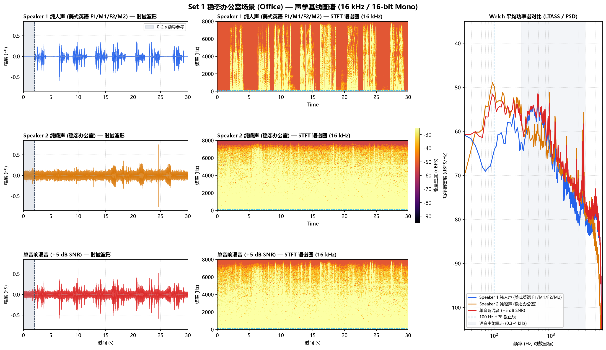
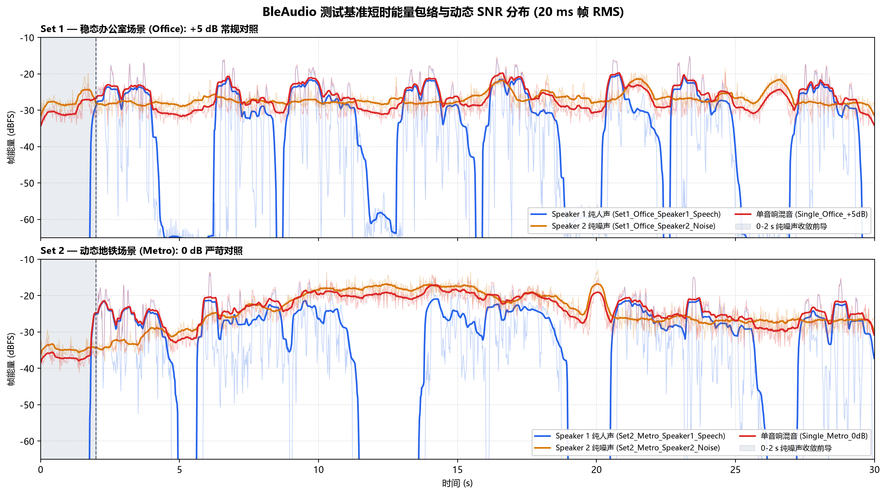
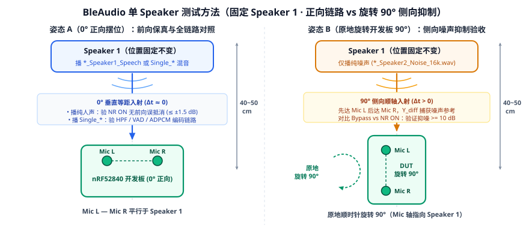
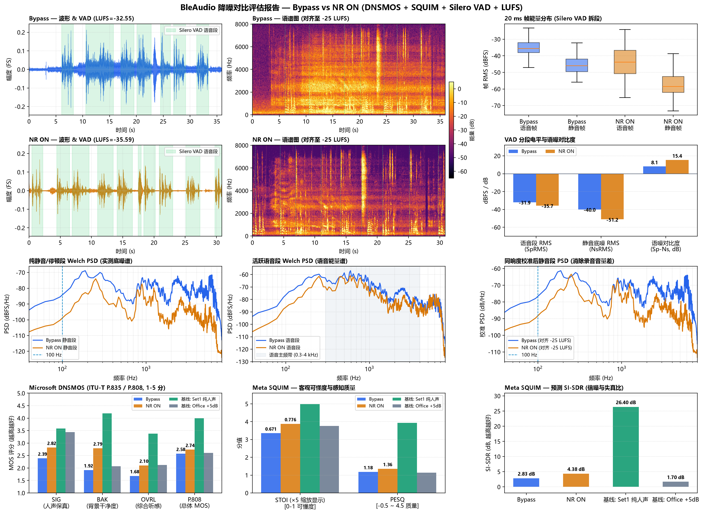

# BleAudio 声学基准套件与实机评测样本 (`sample/`)

本目录存放 **BleAudio** 项目的两类核心声学音频资产：
1. **标准输入基准套件**（[`dual_speaker/`](dual_speaker/) 与 [`single_speaker/`](single_speaker/)）：基于 ITU-T P.501 标准语料构建，`16 kHz / 16-bit / 单声道 PCM`、`30.00 s`、零削波，用于可控外放测试与客观基线对照；
2. **Phase 3 实机录制对照音频**（[`hw_test/`](hw_test/)）：`nRF52840 DK` 开发板（双 MP34DT05TR-A PDM 麦克风 + 收敛版 Phase 3 DSP 固件）通过 BLE L2CAP CoC 实录回传的 **`Bypass` vs `NR ON`** 同环境对比音频及量化报告。

> **上位机评测脚本位置变更说明**：标准化声学评测绘图脚本 `generate_acoustic_plots.py` 与依赖清单 `requirements.txt` 已统一迁移至 [`tools/`](../tools/README.md)，本目录仅保留音频素材、实机对照样本与可视化报告图谱。

---

## 1. 目录结构

```text
sample/
├── README.md                          # 本文件：基准套件规格、外放方法与 hw_test 实机详细报告
├── assets/                            # 基准图谱、测试布局示意图与实机对比报告图
│   ├── set1_office_baseline.png       # Set 1 稳态办公室：波形 / 语谱图 / PSD
│   ├── set2_metro_baseline.png        # Set 2 动态地铁：波形 / 语谱图 / PSD
│   ├── snr_envelope_comparison.png    # 20 ms 短时能量包络与动态 SNR 轨迹
│   ├── hw_test_compare.png            # Phase 3 实机 Bypass vs NR ON 标准化评测对比图
│   ├── test_spatial_setup.svg         # 双 Speaker 90° 正交外放测试空间布局示意图 (SVG)
│   └── test_single_speaker_setup.svg  # 单 Speaker 测试空间摆位与旋转验收示意图 (SVG)
├── dual_speaker/                      # 双 Speaker 空间外放基准套件 (4 个文件)
│   ├── Set1_Office_Speaker1_Speech_16k.wav
│   ├── Set1_Office_Speaker2_Noise_16k.wav
│   ├── Set2_Metro_Speaker1_Speech_16k.wav
│   └── Set2_Metro_Speaker2_Noise_16k.wav
├── single_speaker/                    # 单 Speaker 链路对照 / 离线仿真套件 (2 个文件)
│   ├── Single_Office_+5dB_16k.wav
│   └── Single_Metro_0dB_16k.wav
└── hw_test/                           # Phase 3 开发板实机录制对照音频 (2 个文件)
    ├── test_pcm_bypass.wav            # 实机 Bypass 输出 (150 Hz HPF2 主麦, 35.92 s)
    └── test_pcm_nr.wav                # 实机 NR ON 输出 (1.2 kHz 分频 + 512 点 MCRA-2 OM-LSA, 30.86 s)
```

---

## 2. 标准输入基准套件规格 (`dual_speaker/` & `single_speaker/`)

> **统一格式**：`16,000 Hz` 采样率、`16-bit` 有符号整数 PCM、单声道（1 ch）、`30.00 s`（`480,000` samples）。  
> 原始 `48 kHz` ITU 素材均经 127 阶线性相位 Kaiser 抗混叠低通滤波（`fc = 7000 Hz`, `beta = 8.6`）后严格 3:1 降采样。

### 2.1 双 Speaker 空间外放套件 (`dual_speaker/`)

| 场景套组 | 播放端 | 文件名 | 素材来源 (ITU-T P.501) | 总 RMS (dBFS) | 活跃/底噪 RMS (dBFS) | 峰值 (dBFS) | `0–2 s` 前导 | `<100 Hz` 能量占比 | `0.3–4 kHz` 能量占比 |
| :--- | :--- | :--- | :--- | :---: | :---: | :---: | :---: | :---: | :---: |
| **Set 1 办公室** | `Speaker 1` (`0°`) | [`Set1_Office_Speaker1_Speech_16k.wav`](dual_speaker/Set1_Office_Speaker1_Speech_16k.wav) | `American English B.3.4` (`F1/M1/F2/M2`) | `-27.53` | `-24.25` | `-3.38` | 纯静音 (`-240 dB`) | `2.1%` | `84.0%` |
| **Set 1 办公室** | `Speaker 2` (`90°`) | [`Set1_Office_Speaker2_Noise_16k.wav`](dual_speaker/Set1_Office_Speaker2_Noise_16k.wav) | `off_mono1_30s` (稳态办公室，注 1) | `-26.53` | `-26.53` | `-2.37` | `-26.86 dBFS` | `11.0%` | `47.6%` |
| **Set 2 地铁** | `Speaker 1` (`0°`) | [`Set2_Metro_Speaker1_Speech_16k.wav`](dual_speaker/Set2_Metro_Speaker1_Speech_16k.wav) | `English_FB B.3.3` (`f1/m1/f2/m2`) | `-26.67` | `-24.27` | `-4.31` | 纯静音 (`-240 dB`) | `6.5%` | `57.0%` |
| **Set 2 地铁** | `Speaker 2` (`90°`) | [`Set2_Metro_Speaker2_Noise_16k.wav`](dual_speaker/Set2_Metro_Speaker2_Noise_16k.wav) | `met_mono1_30s` (动态地铁) | `-21.99` | `-21.99` | `-3.10` | `-34.38 dBFS` | `11.6%` | `31.8%` |

> **注 1**：[`Set1_Office_Speaker2_Noise_16k.wav`](dual_speaker/Set1_Office_Speaker2_Noise_16k.wav) 完整保留 ITU 原生波形特征，约 `24.8 s` 处自带短促敲击瞬态尖峰（峰值 `-2.37 dBFS` / Crest `24.16 dB`），其余时段均保持平稳底噪。

### 2.2 单 Speaker / 离线仿真套件 (`single_speaker/`)

| 场景 | 文件名 | 合成基准与标定 SNR | 总 RMS (dBFS) | 峰值 (dBFS) | 峰值因子 (Crest) | `0–2 s` 纯噪声前导 | `<100 Hz` 能量占比 | `0.3–4 kHz` 能量占比 |
| :--- | :--- | :--- | :---: | :---: | :---: | :---: | :---: | :---: |
| **常规稳态** | [`Single_Office_+5dB_16k.wav`](single_speaker/Single_Office_+5dB_16k.wav) | Set 1 人声 + 办公室噪声 (**`+5.00 dB`**) | `-25.32` | `-3.20` | `22.12 dB` | `-29.58 dBFS` | `5.7%` | `69.4%` |
| **严苛动态** | [`Single_Metro_0dB_16k.wav`](single_speaker/Single_Metro_0dB_16k.wav) | Set 2 人声 + 动态地铁噪声 (**`0.00 dB`**) | `-22.31` | `-3.33` | `18.99 dB` | `-36.66 dBFS` | `9.8%` | `41.3%` |

---

## 3. 输入套件声学基线图谱

### 3.1 Set 1 — 稳态办公室场景 (`Office`)



- **前导收敛与语音分布**：`0–2 s` 人声轨静默、噪声轨稳态输出，为固件 `noise_floor_ema`、16 阶 NLMS 与 512 点 `MCRA-2` 子窗提供初始底噪基准；`2–30 s` 分布四位说话人句段，84.0% 能量集中在 `0.3–4 kHz`。

### 3.2 Set 2 — 动态地铁场景 (`Metro`)


- **非稳态与低频隆隆声测试**：`10–18 s` 地铁噪声大幅抬升、`20 s` 存在宽带冲击，且 `< 100 Hz` 能量占比达 `11.6%`，用于压测固件 `150 Hz` 2 阶 Butterworth HPF 抑噪效果及 `MCRA-2` 噪底动态跟踪速度。

### 3.3 20 ms 帧能量包络与动态 SNR 轨迹



---

## 4. 标准外放测试方法与评测脚本调用

### 4.1 外放测试摆位

- **双 Speaker 90° 正交外放**：`Speaker 1`（`0°` 正向播纯人声）与 `Speaker 2`（`90°` 侧向提前 `>= 2 s` 循环播纯噪声），同条件下通过 `BTN3` 或 GATT `0x03` 分别采集 `Bypass` 与 `NR ON`。
  
- **单 Speaker 分步/旋转验收**：`0°` 正向播纯人声验证语音保真，原地顺时针旋转 `90°` 播纯噪声验证侧向抑制，或播 `single_speaker/` 混音验证全链路谱减与 VAD。
  

### 4.2 上位机采集与标准化评测命令（工具位于 `tools/`）

```powershell
# 1. 安装评测依赖（首次运行）
pip install -r tools/requirements.txt

# 2. 在 WSL2 中用 ble_audio_recv.py 接收音频（自动按 FLAG_NR 拆出 *_bypass.wav 与 *_nr.wav）
# python3 tools/ble_audio_recv.py -o tools/test_pcm.wav

# 3. 运行标准化评测脚本，生成对比图并打印 DNSMOS / SQUIM / Silero VAD / LUFS 报告
python tools/generate_acoustic_plots.py sample/hw_test/test_pcm_bypass.wav sample/hw_test/test_pcm_nr.wav --labels "Bypass" "NR ON" -o sample/assets/hw_test_compare.png

# 4. 如需重建 sample/assets/ 中的 3 张输入基准图谱
python tools/generate_acoustic_plots.py --baseline
```

---

## 5. Phase 3 实机对比音频评测报告 (`hw_test/`)

[`hw_test/`](hw_test/) 收录了 Phase 3 收敛固件（`150 Hz` 2 阶 Butterworth HPF + `1.2 kHz` 双麦分频合并 + 静默门控 `16-tap NLMS` + `512` 点 `hop=160` 68.75% 重叠 `MCRA-2 OM-LSA`）在真实声学环境下通过 `BLEAudio_DK` 实时采集传回的一组 **`Bypass` vs `NR ON`** 对比 WAV。

### 5.1 样本基本信息

| 文件路径 | 采样格式 | 时长 | 说明 |
| :--- | :--- | :---: | :--- |
| [`hw_test/test_pcm_bypass.wav`](hw_test/test_pcm_bypass.wav) | `1 ch / 16 kHz / 16-bit PCM` | `35.92 s` | 固件 `nr=0` 旁路路径（主麦 `L` 经 150 Hz 2 阶 HPF + `+15.5 dB` 数字预放大） |
| [`hw_test/test_pcm_nr.wav`](hw_test/test_pcm_nr.wav) | `1 ch / 16 kHz / 16-bit PCM` | `30.86 s` | 同场按下 `BTN3` 切换 `nr=1` 降噪路径（`1.2 kHz` 分频 + 512 点 MCRA-2 OM-LSA） |

### 5.2 标准化声学与降噪对比图谱



### 5.3 量化指标与前后变化明细

> 由 [`tools/generate_acoustic_plots.py`](../tools/generate_acoustic_plots.py) 对 [`hw_test/test_pcm_bypass.wav`](hw_test/test_pcm_bypass.wav) 与 [`hw_test/test_pcm_nr.wav`](hw_test/test_pcm_nr.wav) 实测输出：

| 评估体系 | 指标含义 | Bypass | NR ON | 变化量 (Delta) | 评测解读 |
| :--- | :--- | :---: | :---: | :---: | :--- |
| **DNSMOS P.835** | **SIG（人声保真度）** | `2.389` | **`2.820`** | **`+0.431 MOS`** | 人声主音质显著高于未降噪原始信号 |
| **DNSMOS P.835** | **BAK（背景干净度）** | `1.919` | **`2.793`** | **`+0.874 MOS`** | 强背景底噪环境下感知干净度大幅提升 |
| **DNSMOS P.835** | **OVRL（综合听感）** | `1.684` | **`2.104`** | **`+0.420 MOS`** | 超过对照柱状图中的 `Office +5dB` 基线 |
| **DNSMOS P.808** | **P.808（总体质量 MOS）** | `2.576` | **`2.736`** | **`+0.160 MOS`** | 明显超过对照柱状图中的 `Office +5dB` 基线 |
| **Meta SQUIM** | **STOI（客观可懂度）** | `0.671` | **`0.776`** | **`+0.105`** | 噪声遮蔽显著减轻，字词辨识度提高 |
| **Meta SQUIM** | **PESQ（感知语音质量）** | `1.183` | **`1.358`** | **`+0.175 MOS`** | 无周期性电流调制与严重谐波失真 |
| **Meta SQUIM** | **SI-SDR（信噪/失真比）** | `+2.832 dB` | **`+4.384 dB`** | **`+1.552 dB`** | 噪底能量削减的同时未破坏语音相位结构 |
| **Silero VAD** | **静音底噪 RMS (`NsRMS`)** | `-39.998 dBFS` | **`-51.150 dBFS`** | **`-11.152 dBFS`** | 句间停顿与纯静音段底噪稳态下降 `11.15 dB` |
| **Silero VAD** | **语音段 RMS (`SpRMS`)** | `-31.934 dBFS` | `-35.724 dBFS` | `-3.790 dBFS` | 主要为语段中夹杂背景噪声被剔除后的净电平变化 |
| **Silero VAD** | **语噪对比度 (`Sp - Ns`)** | `+8.064 dB` | **`+15.427 dB`** | **`+7.362 dB`** | 人声与底噪动态对比度拓宽至 `15.43 dB` |
| **ITU BS.1770** | **综合响度 (`LUFS`)** | `-32.555` | `-35.590` | `-3.035 LUFS` | —（图谱 Welch PSD 与语谱图已同对齐至 `-25 LUFS`） |

### 5.4 实测听感与工程结论

1. **高频清亮度与“不发闷”验证**：从 [`hw_test_compare.png`](assets/hw_test_compare.png) 第三行中图（活跃语音段 Welch PSD）可见，在 `1.5–4 kHz` 语音清晰度核心频带，橙线（`NR ON`）与蓝线（`Bypass`）保持高度贴合；得益于 `1.2 kHz` 以上切回主麦 `L` 并提速高频 `alpha_dd = 0.84`，彻底消除了双麦高频相位抵消带来的发闷感，`SIG` 达到 `2.820`、`P.808` 达到 `2.736`。
2. **底噪抑制与零电流声稳定性**：同响度校准后静音段 PSD（第三行右图）显示 `NR ON` 在 `100 Hz – 7 kHz` 宽带底噪整体下移 `10–20 dB`，`68.75%` 重叠 COLA 综合窗与 Bypass 预填充策略完全消除了早期 `100 Hz` 调制电流感与前 10 秒冷启动闪烁。
3. **板端实时性边界**：本组音频采集期间，nRF52840（64 MHz M4F + CMSIS-DSP `arm_rfft_fast_f32` + LUT/IEEE-754 快速近似）单帧 `20 ms` DSP 实测耗时 **`10.4 ~ 14.8 ms`**，全程 `drops = 0`，在传统统计信号处理算力预算内达到了自然度、抑制深度与实时性的最优平衡。
